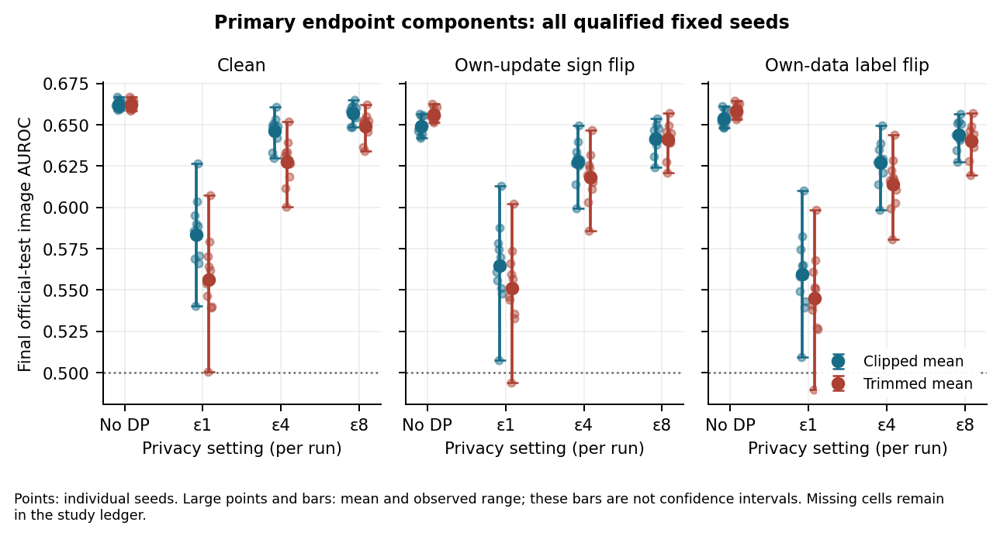
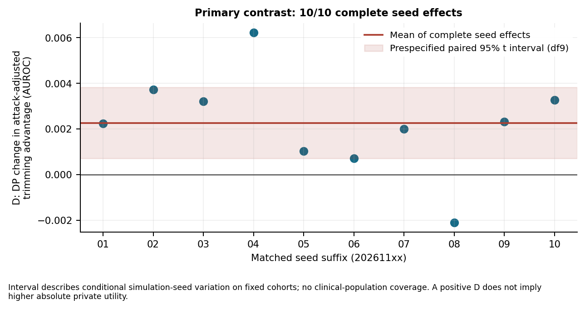

# Measuring the Cost of Privacy and Robustness in Federated Learning

Working title retained from the milestone reports; advisor confirmation remains open. Working report, updated 21 October 2026.
The fixed study completed all 360 cells and passed independent reconciliation.
The additional source-bound reader reproduced all saved analysis exactly. Final
study review and its validation correction are complete. Submission layout, advisor
requirements and final delivery remain open; this is a working report. The current
PDF remains the 20 October rendered snapshot; the dashboard updates below are
Markdown-only until the next layout/render pass.

## Abstract

Privacy and robust aggregation must be chosen together in a federated-learning
platform. This capstone measures their interaction using FedLearn components on
patient-separated, content-audited NIH ChestX-ray14 features. A prospectively frozen
360-cell study compares clipped uniform mean and coordinate-wise trimmed mean,
central privacy targets and own-data/own-update attacks, with bounded head, cohort
and clipping sensitivities. All 7,200 rounds completed; independent decoding and
replay verified all models and both evaluation splits. The ten-seed primary effect
is +0.002266 AUROC (conditional paired 95% interval [+0.000704,+0.003828]), yet private
trimming has lower absolute utility in the primary attacked setting. Larger heads
increase modeled payload without improving the matched clean private point mean;
clipping changes the aggregation ordering. Operating-point and patient-weight
checks materially change interpretation. The contribution is reproducible,
conditional platform guidance and inspectable execution; clinical validity and
patient-level or whole-study privacy are not established.

## 1. Problem and contribution

A federated-learning platform needs to choose aggregation, privacy and training
settings together. A rule that resists malicious updates without privacy noise may
lose that advantage once its sensitivity determines how much noise must be added.
A larger trainable head may increase communication and alter optimization as well
as changing the dimension of the noise. An experiment that hides either effect
can produce a recommendation that does not survive implementation.

This capstone studies that interaction using the FedLearn platform's aggregation
and coordination components in a reproducible single-machine simulator. The primary
question is whether central differential privacy changes the attack-adjusted
advantage of coordinate-wise trimmed mean over clipped uniform mean. Secondary
comparisons measure head size, simulated cohort size and clipping. The intended
contribution is measured, reproducible guidance for platform decisions, together
with a usable dashboard workflow; it is not a new differential-privacy theorem or
a clinical image-classification system.

Correct execution and measurement are part of that contribution. Preliminary work
found that float32 probability saturation can distort AUROC, that submission counts
can be mistaken for successful aggregation, and that an attack reading raw honest
updates can invalidate a downstream single-upload sensitivity premise. These are
separate failure mechanisms. Correcting them before the confirmatory experiment
makes its comparisons interpretable; passing software tests alone does not prove
that the resulting model is useful.

## 2. Related work and comparison boundary

[Guerraoui et al.](https://arxiv.org/pdf/2102.08166) study worker-side noisy gradients
and Byzantine-resilience conditions with a curious server, motivating care when
combining privacy and robustness. Their dimension-dependent analysis does not
automatically characterize our aggregate-noise mechanism.
[Allouah et al. (2023)](https://proceedings.mlr.press/v202/allouah23a/allouah23a.pdf)
analyze item-level distributed privacy of worker-server transcripts and propose
SAFE-DSHB. Its trust model, unit and algorithm differ from this study's conditional
client-update mechanism.

[DP-BREM](https://www.usenix.org/system/files/usenixsecurity25-gu-xiaolan.pdf)
combines record-level privacy with client momentum and noisy centered aggregation;
its DP-BREM+ variant changes the server-trust architecture. The proceedings abstract
for [CafCor](https://proceedings.mlr.press/v267/allouah25a.html) describes robust
aggregation using pairwise secret randomness and correlated noise with an untrusted
server. We have not checked CafCor's proof. Our specific shared-noise cancellation
example therefore must not be generalized to every correlated-noise design.

These works establish relevant context, not interchangeable guarantees or measured
baselines. This capstone evaluates existing FedLearn components under a declared
workload and threat model; it does not claim a new joint algorithm, a reproduction
of these methods, or state-of-the-art superiority. Its useful outcome is a supported
platform decision with reproducible evidence and explicit applicability.

## 3. Data, representation and simulated clients

The workload is NIH ChestX-ray14 with a binary label: an image marked exactly No
Finding is 0; any recognized listed finding or combination is 1. These labels are
derived from radiology reports, not expert-certified image-level diagnoses.
[Wang et al.](https://arxiv.org/html/1705.02315v5) describe the source labelling. We
verified the downloaded metadata and official split lists, rather than substituting
counts from an earlier dataset-paper version. The 112,120 images contain 60,361 No
Finding and 51,759 finding labels before development quarantine.

Patient separation was insufficient to establish independent image content. A full
RGB audit found exact duplicate groups crossing splits and patient identifiers,
including contradictory labels. The original preparation was retained as failed.
A conservative development quarantine then excluded 111 images from nine non-test
patients, preserving the complete official test set. The qualified cohort has
68,650 training images from 22,399 patients, 17,763 validation images from 5,600 patients,
and 25,596 test images from 2,797 patients. No patient appears in two of those groups.
This process addresses measured exact-content overlaps; it is not a near-duplicate
or clinical-label correctness certificate.

Finding prevalence is about 41.54% in training, 42.05% in validation and 61.47% in test.
That reversal makes accuracy alone an inadequate summary. We preserve prevalence,
report AUROC and operating-point/calibration measures, and transfer a threshold
selected on validation without retuning it on test. Test membership, labels,
prevalence, duplicate groups and fixed-backbone features were inspected during
preparation; official-test classifier performance remained unseen until the frozen
confirmatory execution began. This disclosure distinguishes structural data checks
from performance-driven recipe selection.

Images are represented by 512 features from a frozen pretrained ImageNet ResNet-18.
The cache binds source and cohort hashes, transformation, pretrained model state,
row identities and feature/label payload hashes. Direct reference forwards qualified
it before use. No backbone is trained or selected using test performance. The
linear head has 1,026 parameters; MLP hidden widths 8, 128 and 512 give 4,122, 65,922 and
263,682 parameters. Changing width changes capacity and optimization, so the study
compares each private model with its own matched no-DP control.

For each run, sorted whole-patient groups are shuffled and assigned to 10, 80 or 1,000
simulated clients. Patient counts are approximately equal while image counts and
label distributions differ. Ownership is fixed throughout the run and recorded by
an assignment digest and actual counts. These clients are synthetic patient groups,
not observed hospitals, phones or verified institutions. Clients train on their own
assigned data and the simulator aggregates their updates; frozen-feature simulation
is not a benchmark of physical device/network performance.

## 4. Execution and privacy/threat model

The primary recipe uses 80 clients accepted in each of 20 rounds, seven local SGD
epochs per round, learning rate 0.003, batch size 256 and joint L2 clipping C=0.05.
Aggregation is uniform mean or coordinate-wise trimmed mean, removing the largest
and smallest floor(0.2n) values in each coordinate. There is no proximal term, server
optimizer, subsampling credit, dropout, deadline selection or early stopping.

Matched privacy modes are no DP and central DP with epsilon 1, 4 or 8, delta 1e-5 and
replace-one simulated-client adjacency. For a fixed accepted cohort and all other
final uploads fixed, the implementation uses sensitivity 2C/n for mean and
2C/(n−2k) for trimming, k=floor(0.2n). Thus, at 80 clients, trimming's denominator 48
requires 5/3 the coordinate noise SD of mean at the same multiplier. The full-cohort
Gaussian accountant composes 20 rounds over its declared Rényi order grid and classic
epsilon/delta conversion from [Mironov](https://arxiv.org/html/1702.07476). Numerical calibration and every prefix were reconciled
separately in the independent study audit.

The privacy interpretation is conditional on an honest client's replacement, fixed
assignment/accepted cardinality and the permitted prior transcript. The server is
trusted with raw updates. The two attack conditions use sixteen fixed malicious
slots: sign-flip multiplies each slot's own update by −4 before common clipping;
label-flip reverses binary labels on that slot's own data. Neither reads another
client's current raw update. Earlier IPM/ALIE oracle behavior is outside this study;
a production-code counterexample showed why upstream dependence can defeat reuse
of a single-final-upload sensitivity premise.

Observed full-cohort checks do not establish acceptance invariance for every
possible neighboring dataset. Epsilon describes the stated ideal Gaussian mechanism
under its execution premises; a seeded public diagnostic workflow is not itself a
protected deployment release.

The engine's diagnostic record exposes seeds and pre-noise diagnostics and is not
a protected deployment export. Common random numbers across matched private cells
also mean that marginal run budgets cannot simply be added as a joint guarantee.
For two first-round releases of a common query with shared noise at different
amplitudes, a linear combination cancels the noise even if its seed is secret.
This ideal upload-domain example concerns a joint first-round transcript, not a
demonstrated reconstruction from the final-only NIH checkpoints. Per-run accounting does not cover publishing the
entire matrix or tuning history, and patient-separated groups do not convert the
unit into patient-level DP. A deployment would need a separately reviewed release
boundary, secret randomness and accounting for every released mechanism. This
capstone reports conditional research-mechanism comparisons, not those additional
guarantees. The [robust-gradient literature](https://arxiv.org/html/1803.01498v2) is background; its convergence/statistical
results are not transferred automatically to local-SGD deltas, unequal patient-
group sizes, ReLU heads, clipping and Gaussian noise.

## 5. Prospective study and inference

Exploratory validation pilots preceded the study. They exposed scoring/calibration
problems and different local minibatch trajectories as cohort size changed. A later
bounded schedule probe qualified E7/R20 across three seeds. Matched E1/R140 gave
similar exploratory validation utility with seven times the modeled payload, while
changing shuffle/local trajectories. A short four-head cost probe and a twelve-cell
single-seed privacy/attack qualification followed. Their results remain exploratory;
they are not pooled with new confirmatory test effects.

Before official-test classifier scoring, protocol commit `aa7ae53` fixed all 360 cells:
240 primary, 72 head, 24 cohort and 24clipping cells. It specifies ten new primary base
seeds 20261101–20261110, final-round endpoints, matching, failure/resource rules and
one primary contrast. The first three seeds also supply bounded secondary families,
reusing the primary controls rather than rerunning them. No model, round, seed,
clipping norm or cell is selected from confirmatory outcomes.

Let A(r, p, a) be final official-test image AUROC for rule r, privacy p and attack a.
For each seed the attack-adjusted trimming advantage is

B(p)=[A(trim, p, signflip)−A(mean, p, signflip)]
     −[A(trim, p, clean)−A(mean, p, clean)].

The primary effect is D=B(epsilon 4)−B(no DP), averaged over the ten matched seeds.
The report retains all eight absolute components. Positive D means that DP changes
the attack-adjusted advantage in favor of trimming; it does not establish that a
private trimmed model has higher absolute utility. The prespecified approximate 95%
paired t interval uses df 9 and is produced only if all 80 required component cells
qualify. Otherwise complete-pair effects remain descriptive and the interval is
suppressed. No replacement seeds, imputation or available-case formal interval.
The nominal t interval treats the ten seed-level effects as independent replicates
and relies on an approximately normal effect distribution; successful execution
does not verify those assumptions. Within-seed coupling is intentional. It describes
conditional seed variation on fixed cohorts, not clinical-population uncertainty.
The small sample remains a limitation; all other comparisons are descriptive.

Final scores use float64 subtraction of the two stored float32 logits before AUROC.
Default prediction is finding only for a positive margin, with ties assigned 0.
For each model, a second operating threshold is the highest validation margin
achieving at least 80% finding recall, including ties; it transfers unchanged to test.
The report includes confusion counts, sensitivity, specificity, balanced accuracy,
accuracy, logistic loss and ten-bin argmax-confidence ECE. Inverse images-per-patient
weights diagnose uneven repeated images but do not create a patient classifier.
A prespecified secondary mask excludes nine test images from seven patients in
known contradictory-label content groups; primary membership remains unchanged.

## 6. Reproducibility and evidence qualification

The source-bound runner was committed at `3baea7d` after 68 focused and 2,076 full framework
tests passed,14 tests were deselected and coverage was 81.66%. Two launch-blocking
review findings were first reproduced: parent thread settings differed from saved
prediction recipes, and malformed protocol/config files were not treated as global
integrity failures. Regression-backed corrections preceded real execution.

All 360 configurations/hashes and pending outcomes are persisted before launch. Each
cell runs in a fresh process with four CPU threads and at most 180 seconds; combined
child execution is bounded by 10,800 seconds. Parent verification/control time is
separate. An engine-completion process high-water RSS observation over 2 GiB rejects
qualification; it is not an enforced process-tree or late-artifact memory cap.
Ordinary failure retains evidence and later fixed cells continue. Source/cache/mask/
protocol/config integrity failure stops later launches. No concurrent test suite or
tracked source edits run during capture.

Each successful cell binds the qualified record, actual final server parameters,
checkpoint, validation/test scores and row identities. Start/end proofs identify
loaded source bytes; a start proof survives abrupt interruption. Returned records
survive later artifact errors, and failed/nonfinite/timeout/unrun outcomes remain
visible. Reanalysis reopens raw artifacts and rejects missing hash entries or edited
summaries rather than trusting the study index.

The separate checker passed all 360 final models, both split replays, 7,200 rounds,
148 committed source files and 16 patient allocations. It imports no project
configuration, runner, model, codec, metric or accountant. It resolves source bytes
from Git, reconstructs recipes/ownership, parses checkpoints, performs direct
Torch forwards, recomputes rank AUROC and threshold/weight/mask/accounting/cost
arithmetic, and rebuilds the primary contrast with a separate signed sum.
Sharing underlying Torch kernels is disclosed: exact replay demonstrates consistency
under the fixed runtime, not cross-hardware equality or independent clinical truth.
Source and ignored evidence are separately backed up with per-file hash verification.

## 7. Results and practical platform decisions

All 360 fixed cells qualified once, with no failures/timeouts/unrun cells: 240
primary, 72 head, 24 cohort and 24 clipping cells. No outcome was replaced. Across
ten matched seed effects, D=+0.002266150 AUROC, sample SD 0.002183178 and the
prespecified paired 95% t interval is [+0.000704398,+0.003827901]. Mean B is +0.007443034
without DP and +0.009709183 at epsilon 4. The interval excludes zero under the declared
method but the effect is small, conditional on fixed cohorts, and not a clinical
population or practical-equivalence statement.

| Condition | Mean, no DP | Trimmed, no DP | Mean, epsilon 4 | Trimmed, epsilon 4 |
| --- | ---: | ---: | ---: | ---: |
| Clean |0.662202|0.662033|0.646336|0.627488|
| Own-update sign flip |0.648991|0.656265|0.627389|0.618250|

These eight absolute components prevent an interaction-only recommendation. Without
DP, trimming improves attacked AUROC; at epsilon 4, its attacked point mean is lower
than mean by 0.009139 AUROC, and its clean baseline is lower too. The positive D
measures a change in the attack-adjusted advantage, not superior private utility.
The complete epsilon 1/4/8 and label-flip grid, all seed effects and descriptive
ranges are retained in the [study report](nih-phase2-study-v1-report.md) and tables.

The secondary families are descriptive, using three matched seeds. For clean
clipped mean at epsilon 4, linear and MLP512 point means are 0.644213 and 0.643233,
while modeled upload increases from 6.8 MB to 1,688.0688 MB across 80 clients/20 rounds.
This supports requiring a measured learning benefit before accepting the extra
payload; it does not establish equivalence, an optimum head or convergence after
other tuning. Matched privacy penalties are not monotone in width.

Cohort size also requires a learning check. Clean private mean point means are
0.548356/0.644213/0.630644 for 10/80/1,000 clients. The thousand-client private/no-DP
gap is smaller, yet its absolute private mean is lower than the eighty-client value.
Local trajectories change along with aggregate sensitivity; these results do not
measure physical-client scaling or isolate a pure noise effect.

Clipping changes the decision. At C0.4 under sign-flip, no-DP mean averages 0.495854
versus 0.658057 for trimming; private epsilon 4 means are 0.520096 and 0.546027.
Changing C changes useful signal truncation, attacker influence and calibrated noise
together. Validate clipping with the intended threat/privacy setting instead of
transferring one rule ranking across configurations.

For primary clean epsilon 4 mean, the validation-selected 80% recall threshold yields
test recall 0.915729 and specificity 0.241375 across ten models, against default
recall 0.619790. The validation target does not guarantee a new-data operating point.
Inverse-patient weighting raises that group's AUROC by 0.077657 on average; this is
a weighting diagnostic, not a patient classifier or a replacement primary endpoint.
The frozen nine-image exclusion changes any model's AUROC by at most 0.000165502.
Its small measured effect does not validate all labels or near-duplicate independence.

The original study used 10446.316 child seconds and 2834.088 parent-control seconds,
13280.404 in total. Maximum recorded engine-completion high-water RSS was 1573.469 MiB.
Modeled bytes/FLOPs, observed timing/memory scope, fixed order and power/background
conditions must remain visible in the platform. The [practical guidance](fedlearn-practical-guidance.md)
maps these findings to comparison, admission, scoring and lifecycle actions.

## 8. Limitations and remaining delivery

Early capture was observed on battery, followed by restoration of external power.
An in-flight backup copied closed outputs while the study continued. Report these
background/power conditions with the fixed-order limitation; measured wall-time
differences are descriptive, not isolated hardware/algorithm scaling effects.

The representation is frozen and not domain-trained by this project; labels come
from reports, exact duplicate curation is conservative and incomplete for near-
duplicates, and the official cohort shows measured prevalence differences. There is
no external clinical validation or verified hospital/device distribution. Fixed
seed pairing does not make stream components numerically independent. Head/cohort/
clipping manipulations change multiple learning mechanisms, so raw differences do
not establish a noise-only causal explanation. Secondary comparisons are bounded
and descriptive, and terminal resource failures must remain part of the report.

The dashboard now passed actual browser-to-API-to-worker checks: two three-round
validation jobs completed, a separate job stopped with two of twenty rounds retained,
and reload/export/comparison/ownership and disabled-workload behavior were checked.
These short, differently seeded demonstration runs are not new matched research
comparisons or a disease-specific baseline. A screenshot-exposed mobile clipping
failure was corrected and verified with visible-control-width and keyboard checks.
The [verification receipt](simulation-lab-browser-verification-2026-10-21.json)
and [live/replay guide](simulation-lab-demo-guide.md) preserve the evidence boundary.

Final submission review, the next rendered layout, advisor-approved title/format,
presentation and full rehearsal remain delivery gates. The stronger disease-specific
follow-up also remains separate and unqualified. A working simulator does not complete
the assessed capstone without the remaining scientific and delivery evidence.

## 9. Conclusion

The measured privacy/robustness interaction is small and positive, while absolute
private utility and its practical ordering depend on aggregation, clipping and
learning configuration. This motivates a platform workflow that presents matched
controls, actual accepted cohorts, rule-specific calibration, operating points and
resource scopes together. Data/content qualification and versioned score arithmetic
are prerequisites for trusting that comparison. The study supplies reproducible
evidence for those decisions; it does not certify a clinical model or a protected
end-to-end deployment. The integrated dashboard makes execution, partial outcomes,
configuration differences and cost/privacy scopes inspectable. Its verified local
workflow supports delivery; stronger prediction baselines and the final report,
presentation and rehearsal still require completion.

## Working evidence links

- [Related-work source checks and comparison scope](related-work-and-scope.md).

- [Frozen study protocol](nih-phase2-study-v1-protocol.md) and [runner contract](nih-phase2-runner-contract.md).
- [Current checklist](capstone-todo.md), [claim register](final-report-evidence-map.md) and [reproduction guide](phase2-reproduction-guide.md).
- [Practical decisions](fedlearn-practical-guidance.md), with eight quantitative study recommendations and their conditions.

This v2 working draft does not replace the historical phase-1 final report or
the presented Milestone 2 material. The eight-page target is a working layout
budget; advisor formatting requirements and title approval remain unverified.
