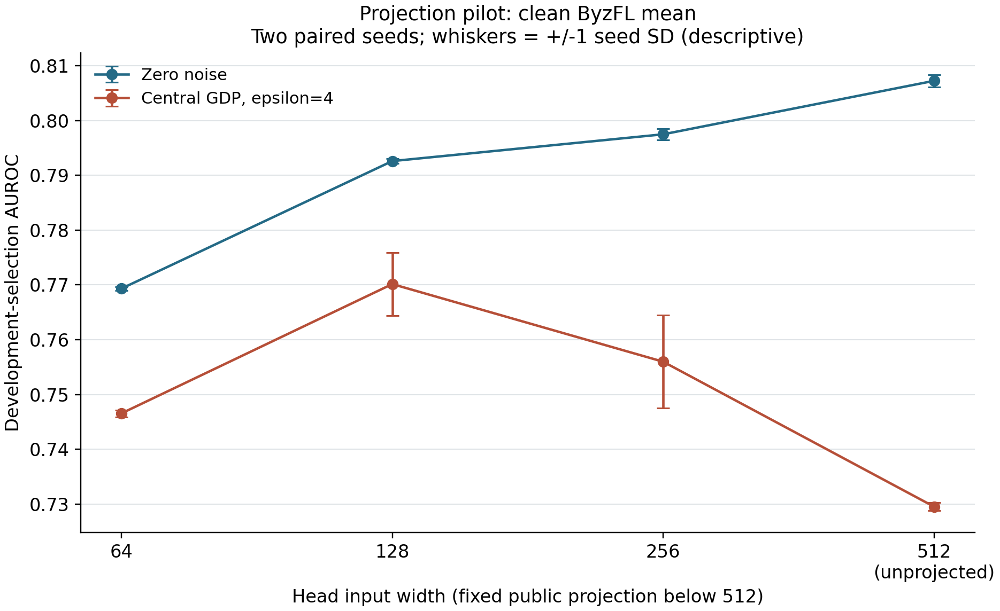
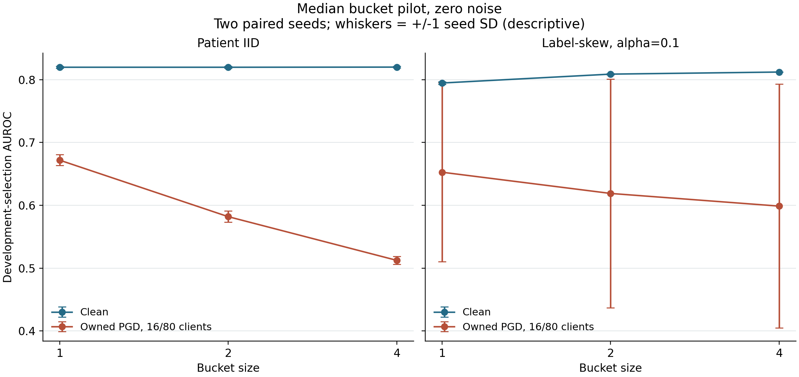
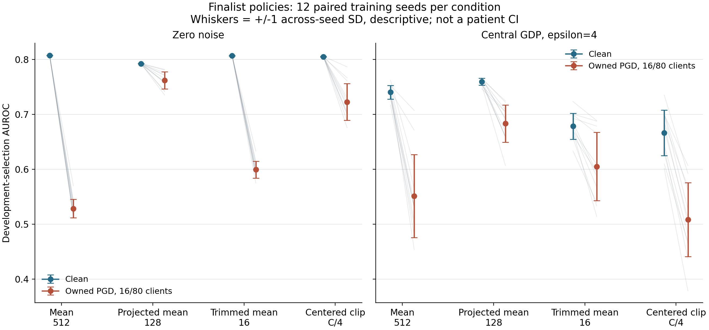
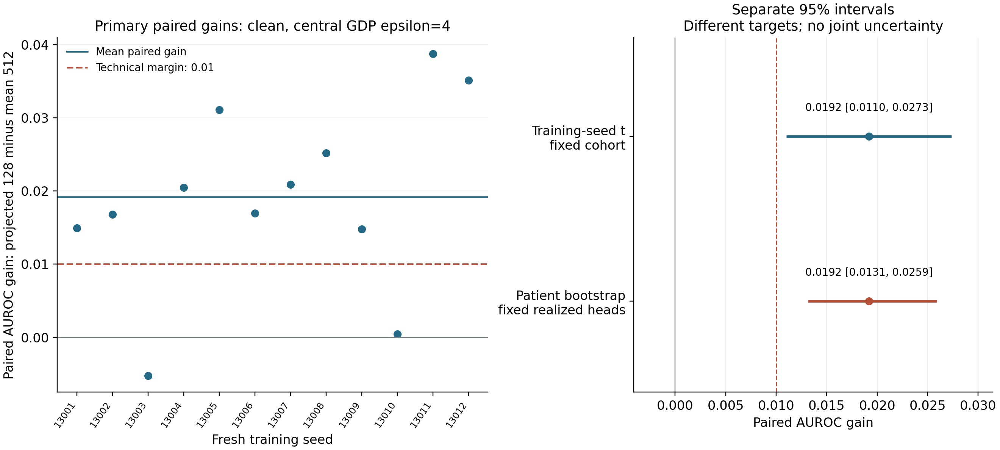

# Measuring Privacy and Robustness Trade-offs in Federated Learning

Anurag Lnu | MS Computer Science | Rochester Institute of Technology

Working report, 25 October 2026. Research evidence and implementation review; advisor formatting and submission approval remain separate.

## Abstract

This capstone evaluates how aggregation, clipping, privacy calibration and malicious-client behavior interact in a federated-learning platform. It uses patient-separated NIH ChestX-ray14 frozen features and a linear head, with simulated whole-patient clients. The historical prospectively frozen 360-cell any-finding study found a small positive privacy-by-aggregation interaction, while private trimming still had lower absolute utility than the mean in the primary attacked setting. Later Effusion experiments exposed weaker-than-assumed attacks, initialization effects, privacy-unit mismatches and unsupported equivalence claims. A remediation study qualified a pinned ByzFL backend, completed 126 diagnostic runs and 196 fresh-seed comparison cells, and introduced an attacker restricted to coalition-owned data and public history. Projection to 128 features improved private-clean AUROC by +0.0192 (seed 95% interval [+0.0110,+0.0273]), less than half the pilot estimate, with a 0.0149 clean no-noise cost. Trimming and centered clipping had condition-dependent outcomes. The contribution is reproducible, conditional evidence for platform decisions. No universal best method, clinical qualification, protected whole-study release or production secure-aggregation guarantee is established.

## 1. Verdict and research contribution

The original conclusion was broader than the evidence supported. Comparing mean and trimming under a weak sign-flip attack could not establish that robust aggregation is generally ineffective under privacy. A positive interaction could coexist with worse private attacked utility. Similar point estimates could not establish equivalence, and an aggregate-input sensitivity calculation could not automatically cover attackers whose uploads depend on raw honest updates.

The useful research question is narrower: for a declared workload, threat model, client unit and training budget, which composite choices preserve useful prediction under privacy noise and malicious updates? The platform contribution is the machinery needed to answer that question honestly: enforced configuration semantics, accepted-cohort accounting, source-bound execution, reliable ranking metrics, qualified attacks and complete outcome retention. The empirical contribution is a set of measured trade-offs and counterexamples to unconditional defaults.

The capstone does not introduce a new robust-private optimization theorem. Its simulation shares implementation components with FedLearn but does not demonstrate deployment across hospitals or physical devices. Neither a large run count nor passing tests establishes external validity.

## 2. Evidence layers and chronology

| Evidence layer | Design and role | Interpretation |
| --- | --- | --- |
| Historical any-finding study | Prospectively frozen 360 cells, 7,200 rounds; ten-seed primary contrast | Original declared question, conditional on its cohorts and recipe |
| Effusion development, A1-A23 | Representation, privacy, attack and implementation follow-ups | Many adaptive development decisions; later results require exploratory interpretation |
| A10 internal holdout | One opening of 8,688 images from 2,800 patients for the previously frozen models | Internal patient-disjoint evaluation of those models only; reused here through published aggregates |
| Remediation qualification | Four native/ByzFL cells and prior-reference reconciliation | Backend compatibility and calibration check, not a new predictive claim |
| Diagnostic pilots | 80 screen cells and 46 nonprivate bucket cells | Two-seed policy/attack qualification and retained negative results |
| Fresh-seed finalists | Frozen four-policy, two-noise, two-attack design; twelve new seeds; four native anchors | Training-seed comparison on the same reused development-selection cohort |

The holdout and official test inputs, labels, predictions and models were not reopened during remediation. Fresh training seeds improve evidence about training variability; they do not create a new evaluation cohort or undo policy selection on that cohort.

## 3. Data, representation and client model

NIH ChestX-ray14 labels were mined from radiology reports. They are weak labels rather than adjudicated image diagnoses [1]. The historical task classified any recognized finding against exactly No Finding. The later task marks the exact Effusion token as positive, with all other labels negative.

The preparation audit found exact RGB duplicates crossing splits and patient identifiers, including conflicting labels. A conservative development quarantine removed 111 images from nine patients while retaining the official test set. Qualified historical groups contain 68,650 training images from 22,399 patients, 17,763 validation images from 5,600 patients, and 25,596 official test images from 2,797 patients. Exact-content checks do not certify absence of near-duplicates or correct clinical labels.

For Effusion, validation patients were assigned label-independently into selection (9,075 images, 2,800 patients) and internal holdout (8,688 images, 2,800 patients). The validation population had already been used for the historical any-finding task. The Effusion holdout was therefore internal and target-specific, with the limitations documented before its opening.

R0 uses frozen ImageNet ResNet-18 features of width 512 and a two-output linear head with 1,026 parameters. A fixed public orthonormal projection to width 128 gives 258 parameters. The backbone is not fine-tuned. Training-only normalization and the prepared feature bundle are treated as fixed shared inputs to the studied update mechanism. Their preparation is not included in a whole-pipeline private guarantee.

Eighty simulated clients receive whole patients. IID assignment mixes the source population; Dirichlet label-skew diagnostics change that allocation. These clients are not eighty observed hospitals. The experiments do not reproduce institutional scanner, acquisition or population shift. Uniform client averaging also differs from an image-weighted centralized objective.

## 4. Privacy and threat-model boundaries

The principal new comparison assumes a trusted coordinator that sees individual updates, clips them and releases a Gaussian-noised aggregate. Its privacy unit is one simulated client under replace-one adjacency, conditional on the fixed cohort and preprocessing. In attacked arms the bound protects replacement of one honest client, with coalition identities/data fixed and conditional on released history. Replacing a coalition member can change multiple malicious uploads and is not covered by the single-upload bound. It does not provide local privacy against that coordinator. One simulated client contains many patients; client-level calibration must not be relabeled as a measured patient-level end-to-end guarantee.

Every round has all eighty clients. At clipping radius C, mean sensitivity is 2C/80. Coordinate trimming [2] removes sixteen values at each end, leaving denominator 48 and sensitivity 2C/48. The centered policy clips each update relative to the previously released delta at radius tau, giving sensitivity 2tau/80 conditional on that released history. The smaller centered bound comes with a changed update rule; it is not free noise reduction.

For twenty full-participation Gaussian releases, mu-GDP composition uses mu = sqrt(20)/z. The epsilon 4, delta 0.00001 calibration has z approximately 4.8351. A separate normal-CDF calculation checks the delta trade-off. At C=0.05, mean coordinate noise SD is about 0.006044; trimming has 5/3 times that SD; tau=0.0125 gives centered SD about 0.001511. Matching epsilon therefore does not match noise amplitude or optimization behavior. Full participation is essential to this particular accounting calculation [3].

Public experiment seeds, raw updates, saved heads, metrics, clipping diagnostics and policy selection belong to a research workflow. Their combined publication is not covered by a single epsilon 4 claim. Public or shared random streams are not a protected deployment randomness design. Floating-point execution and observable failure paths are not a certified implementation of mathematical DP. Secure summation, distributed noise and central DP are distinct trust arrangements, not interchangeable privacy labels.

The qualified owned-data PGD attacker controls sixteen persistent clients. It uses coalition-owned examples and updates plus released global/history values. It has twenty ascent steps, three restarts and step ratio 0.25: sixty gradient and sixty-three loss evaluations per round. It does not read selection labels or current raw honest updates. Its objective uses a uniform-mean surrogate, rather than the actual trim or centered reducer; it is a damaging permitted-information heuristic, not a reducer-specific worst-case attack. A full-norm negative coalition mean initializes the search. Mandatory server clipping bounds the represented reducer inputs even when float32 reconstruction slightly exceeds the intended pre-server radius.

Oracle Fang, min-max and raw-honest-update attacks remain useful stress tests. Their data dependence can invalidate the single-upload client-data sensitivity premise; nominally adding aggregate noise does not repair that missing proof. They are reported separately from qualified private attacks.

## 5. Historical findings and corrected interpretation

The 360-cell any-finding study completed all planned cells and rounds. Its ten-seed primary privacy-by-trimming interaction was +0.002266150 AUROC, with paired training-seed t95 interval [0.000704398, 0.003827901]. The relevant absolute components explain why that interaction is insufficient for a recommendation:

| Historical condition | Mean AUROC | Trimmed mean AUROC |
| --- | ---: | ---: |
| Clean, no noise | 0.662202 | 0.662033 |
| Sign flip, no noise | 0.648991 | 0.656265 |
| Clean, private epsilon 4 | 0.646336 | 0.627488 |
| Sign flip, private epsilon 4 | 0.627389 | 0.618250 |

Trimming reduced attack damage in parts of that recipe but had worse private attacked absolute utility. A positive interaction is not a positive private treatment effect. Broader head, cohort and clipping comparisons were descriptive, with smaller seed budgets. Modeled communication changes are not measured network performance or an equivalence result for utility.

A10's already-published internal holdout aggregates give clean FedAvg AUROC about 0.836 and centralized convex AUROC about 0.835. Their paired difference interval [-0.0021, 0.0044] crosses zero; this establishes neither equality nor noninferiority. RDP-calibrated private targets epsilon 8/4/1 gave about 0.763/0.715/0.580. At the transferred selection-frozen operating points, sensitivity was about 0.908-0.923 and specificity fell from about 0.545 to 0.386/0.296/0.141. That is a result at those operating points, not a general law that privacy only costs specificity. Clinical triage value was not assessed.

Later selection experiments found that exact full-participation calibration and zero initialization improved the tested private frozen-head recipe. They also found weak local-DP utility, local-noise integrity failures, skew sensitivity and a distributed-noise clip-skipping failure. A23 also lacks sufficient unknown honest noise under the claimed collusion threshold: its mu/N allocation does not establish the desired DP bound after colluders reveal their shares. This privacy qualification is independent of the utility failure. These are conditional findings. Close noise scales do not establish distributed/central utility equivalence; a norm-matching evasion does not prove all integrity checks impossible; and a wider encoder comparison does not isolate a causal dimension effect.

The retrospective reanalysis reproduced 173 saved contrasts from eight pinned summaries. Patient-cluster intervals conditional on realized heads and training-seed intervals conditional on fixed patients answer different questions. Neither substitutes for joint training-and-population uncertainty. Corrected prose preserves the original measurements and source hashes.

## 6. Diagnostic remediation findings

The pinned ByzFL 0.0.11 adapter reproduced the native mean exactly in clean and private qualification cells, including every final parameter. It also matched the prior A17 reference. This supports integration fidelity for the checked path; it does not validate every ByzFL algorithm or the whole platform.

All eighty screen cells completed. Of these, sixty-eight used iterative federation and twelve used a scalar strongly convex client-private ERM comparator. The scalar solver includes a finite-iteration sensitivity allowance and intercept regularization; its output perturbation is a distinct one-release mechanism and parameterization. The tested private utility was weak, which rejects that recipe as a finalist without rejecting all convex private methods.

| Two-seed screen policy | Clean, no noise | PGD, no noise | Clean, GDP4 | PGD, GDP4 |
| --- | ---: | ---: | ---: | ---: |
| Mean512 | 0.8073 | 0.5201 | 0.7295 | 0.5963 |
| Trim16 | 0.8070 | 0.5864 | 0.6586 | 0.6136 |
| Center tau/C=0.25 | 0.8051 | 0.7028 | 0.6714 | 0.5423 |
| Center tau/C=1 | 0.8073 | 0.6033 | 0.5604 | 0.5302 |
| Center tau/C=4 | 0.8073 | 0.5201 | 0.7289 | 0.5967 |

Owned PGD reduced nonprivate mean AUROC by 0.2872. Original sign flip reduced it by only 0.0050, and full-norm coalition-mean sign flip by 0.0075; both failed the declared 0.02 damage qualification. A result against the original weak attack could therefore have overstated robustness. This attack is stronger in the measured positive control, not proven optimal or representative of every adversary.

Projection widths 64/128/256 gave private clean means 0.7465/0.7702/0.7560, versus 0.7295 at width512. The corresponding no-noise means were 0.7693/0.7926/0.7975 versus 0.8073. Width 128 was selected by the declared private clean criterion: paired gains 0.0360543 and 0.0452283, at an observed clean no-noise cost of about 0.0147. Projection changes both signal and noise geometry; the evidence does not isolate noise dimension as the sole cause.

The scalar output-perturbed ERM private means were about 0.5345, 0.5434 and 0.5483 for the three tested regularization values. The bounded shortlist therefore advances projection128, trim16 and center_quarter alongside mean512. Center_quarter is retained to test a nonprivate-robustness/private-utility reversal, not because it won private utility.

The screen clean-median controls selected LR0.1/C1 using the declared recipe rule; the separate forty-six-cell nonprivate bucket stage used that recipe. Under strong label skew, increasing bucket size from one to four raised clean AUROC from about 0.7947 to 0.8122. With sixteen owned-PGD attackers, the corresponding means fell from 0.6527 to 0.5987; for the oracle Fang stress test they fell from 0.6313 to 0.4115. Larger buckets can mix heterogeneity while also spreading malicious influence. The observed pattern and recorded contamination are consistent with that mechanism, but do not establish it as the only cause. Two seeds show large attacked variability. Private bucketing was not qualified or silently added.

## 7. Fresh-seed comparison

The prospective design has 192 main cells: four policies, two noise settings, clean or owned-PGD attack, and twelve fresh seeds 13001-13012. Four additional native-mean anchors give 196 planned cells. The first eight runs complete four native/ByzFL comparisons before later fitting. All policies share zero initialization, eighty whole-patient IID clients, twenty rounds, seven local epochs, batch 256, LR 0.03 and outer C 0.05. This controlled recipe compares composite mechanisms; it is not equal-effort per-method optimization or a certificate of each method's best attainable performance. Projection uses a fixed public orthonormal basis at seed 20261025; trimming removes sixteen values at each end; center_quarter uses tau 0.0125 and the previously released delta.

The primary is projected128 minus mean512 AUROC in private clean cells. A paired two-sided t95 interval across twelve training seeds is conditional on this fixed selection cohort and selected policies. Its technical practical margin is +0.01 AUROC, without clinical meaning. A separate 2,000-draw whole-patient percentile bootstrap at seed 20261025 holds all twelve realized head pairs fixed, carries all images of sampled patients and preserves image-level weighting. This second interval conditions on the fitted heads. Neither is a joint training-and-population interval or a policy-selection correction. Thirty secondary contrasts are descriptive and unadjusted for multiplicity; all absolute components accompany the interactions. A wholly negative primary interval is reported as harm, rather than merely unresolved.

Every main arm also reports average precision, Brier score and sensitivity/specificity at probability 0.5 in the aggregate tables. These fixed-threshold diagnostics are descriptive; they are not A10's transferred sensitivity-targeting thresholds, a new clinical operating point or a recalibrated model.

All 196 cells completed, including 192 main cells and four native anchors: 3,920 full eighty-client rounds. Every saved head passed five-metric rescoring and independent weighted-AUROC checks. Native/ByzFL parameter differences were exactly zero in all four comparisons. A separate audit verified all 150 frozen/archive/live source files, 98 private cells and 1,920 PGD rounds, and reproduced all 31 paired-seed contrasts with maximum difference 5.6e-17.

The primary private-clean mean gain is **+0.019176 AUROC**, with approximate training-seed t95 interval **[+0.011011, +0.027340]**, SD 0.012850, SE 0.003709, and 11 degrees of freedom. This meets the frozen +0.01 technical-margin criterion, but its lower endpoint clears that margin by only 0.001011. The separate fixed-head patient-cluster interval is **[+0.013136, +0.025893]**, from 2,000 valid draws with zero skipped draws. It is not a joint interval or an independent validation of policy selection.

The gain is less than half the two-seed pilot estimate (+0.0406), and its seed SD is about twice the pilot SD. One fresh seed favored the full-width mean (gain -0.00525), and another gave only +0.00042. The pilot effect did not carry over at its original magnitude; the fixed twelve-seed comparison materially changed the estimate. These observations do not identify selection optimism as the sole cause of the shrinkage.

| Finalist policy | Clean, no noise | PGD, no noise | Clean, GDP4 | PGD, GDP4 |
| --- | ---: | ---: | ---: | ---: |
| mean512 | 0.8073 | 0.5285 | 0.7404 | 0.5513 |
| projected128 | 0.7924 | 0.7618 | 0.7595 | 0.6833 |
| trim16 | 0.8070 | 0.5994 | 0.6784 | 0.6051 |
| center_quarter | 0.8051 | 0.7227 | 0.6665 | 0.5083 |

Projection had the highest observed attacked mean among these four policies, both without noise and with GDP4. Its private attacked gain over mean512 was +0.1320, with a descriptive unadjusted seed interval [+0.0829,+0.1812]. This is evidence for the tested projected mechanism under this mean-surrogate attack; it is not a worst-case robustness guarantee or an exhaustive best-method result. Projection also lost 0.0149 AUROC in the clean no-noise condition, so it is not an unconditional default.

Trimming lost 0.0620 private-clean AUROC relative to mean512, yet gained 0.0538 in the private attacked condition, descriptive seed interval [+0.0330,+0.0747]. The earlier blanket preference for mean under privacy therefore does not extend to this qualified attack/recipe. Center_quarter improved nonprivate attacked utility but had private means 0.6665 clean and0.5083 attacked; its smaller formal sensitivity did not deliver better private utility. All secondary intervals are unadjusted, and direct all-method superiority was not the prespecified primary test.

## 8. Existing systems and methods not tested

ByzFL supplies reusable aggregators, preaggregators and attacks [7]. It substantially reduces implementation work. A library call still requires correct clipping order, privacy sensitivity, history state, attack knowledge, reproducible configuration and matched metrics. The one-step released-history center used here is not a full reproduction of every published worker-momentum method.

NVIDIA FLARE documents federated orchestration, sample-level DP-SGD through Opacus and model-update privacy filters [8]. Its PercentilePrivacy filter implements a clipping/sparsification policy; that policy alone is not the calibrated end-to-end guarantee studied here [9]. No matched NVFlare predictive benchmark was performed. Public framework documentation cannot establish which mechanism NVIDIA deploys internally, and this report makes no such claim.

SAFE-DSHB and DP-BREM have relevant but different privacy units, transcripts, trust assumptions or optimizer protocols [4-6]. CafCor uses correlated noise with pairwise secret randomness [12]; the shared-noise cancellation example in this project must not be generalized to every correlated-noise design. The 2026 Byz-Clip21-SGD2M work combines clipping, double momentum and error feedback under sample-neighbor local privacy [10]. It is a candidate for a separate protocol-level reproduction, not a server-reducer swap supporting client-level central-DP superiority. Recent low-rank private fine-tuning also changes the training target [11]. These omissions rule out a state-of-the-art or exhaustive-best claim. The accompanying literature refresh records the comparison boundary and follow-up priorities.

## 9. Reproducibility, tests and failure accounting

Each new real stage was preceded by a local checkpoint binding protocol, source, runtime, bundle and resolved configurations. Private evidence retains raw records and saved heads. Public exports contain aggregate metrics, configurations and nonidentifying hashes rather than patient identities or predictions. Existing outputs are refused; incomplete and failed cells remain explicit. Native/ByzFL anchor failures stop subsequent fitting.

The 126 pilot cells completed 2,280 iterative rounds. Separate audits checked cohort cardinalities, attack budgets, sensitivities, noise and saved-head metrics. Independent rank-sum AUROC and threshold-tie AP calculations agreed within floating-point tolerance, with largest metric difference below 2.3e-16. All 140 pilot source hashes matched at the audit before final-stage development.

The permitted full framework suite passed 2,378 tests with fourteen deselected and 80.15 percent coverage. The first sandbox run had local-socket permission failures; the retained permitted rerun resolved them. Reproduction helpers have scoped generated-data tests for configuration mutations, failure suppression, interval arithmetic, identity binding and export boundaries. These checks support execution correctness. They do not prove privacy against all implementation leakage or compensate for a reused selection cohort.

The evidence map, phase receipts and source-bound reproduction commands accompany this report. Historical artifacts are preserved; a corrected interpretation is not an unrecorded replacement of a measurement. All remediation commits remain local unless separately integrated.

## 10. Practical conclusions and remaining work

For this tested recipe, projected128 is the strongest current research candidate under central privacy, while the full-width mean retains higher clean no-noise utility. Center_quarter is unsupported as a private default; trimming trades private-clean utility for better attacked points. These findings justify a next research baseline, not an unqualified deployment default.

Aggregation should be selected from absolute clean, private and attacked utility under the intended client model. A favorable interaction or a smaller formal sensitivity is insufficient. Attack qualification must precede defense ranking. Initialization, privacy accounting and trainable dimension can matter as much as the aggregator, but their observed advantages remain recipe-dependent.

A trusted-central client-DP baseline is defensible as the comparison studied here. Local or distributed privacy offers different trust guarantees and needs a separately matched protocol and integrity analysis. The distributed clip-skipping failure is a reason to avoid a deployment claim, not evidence that cryptographic defenses are universally impossible.

The most valuable next scientific extension is an independently frozen external or new institutional cohort, coupled with a deliberately small protocol-level modern baseline. More tuning on the same selection patients will not resolve generalization. A secondary robustness study should cross realistic heterogeneity with the qualified attack and include a bounded NNM/ARC shortlist after checking each composite sensitivity. A matched NVFlare port is useful for integration and operational cost, with predictive parity established before any runtime comparison. Production secure aggregation, malicious-input enforcement and private randomness require a separate engineering and security scope.

Advisor title/format confirmation, final presentation rehearsal and actual submission remain human review steps. They are not represented as completed by this research report.

## References

- [1] Wang et al. ChestX-ray8 and ChestX-ray14 appendix. https://arxiv.org/html/1705.02315v5
- [2] Yin et al. Byzantine-Robust Distributed Learning: Towards Optimal Statistical Rates. https://proceedings.mlr.press/v80/yin18a.html
- [3] Dong, Roth and Su. Gaussian Differential Privacy. https://arxiv.org/abs/1905.02383
- [4] Guerraoui et al. Differential Privacy and Byzantine Resilience in SGD: Do They Add Up? https://arxiv.org/abs/2102.08166
- [5] Allouah et al. On the Privacy-Robustness-Utility Trilemma in Distributed Learning. https://proceedings.mlr.press/v202/allouah23a.html
- [6] Gu, Li and Xiong. DP-BREM. https://www.usenix.org/conference/usenixsecurity25/presentation/gu-xiaolan
- [7] ByzFL documentation. https://byzfl.epfl.ch/
- [8] NVIDIA FLARE differential privacy documentation. https://nvflare.readthedocs.io/en/main/user_guide/admin_guide/security/differential_privacy.html
- [9] NVIDIA FLARE PercentilePrivacy API. https://nvflare.readthedocs.io/en/main/apidocs/nvflare.app_common.filters.percentile_privacy.html
- [10] Islamov et al. Byzantine-Robust and Differentially Private Federated Optimization under Weaker Assumptions. https://arxiv.org/html/2603.23472v1
- [11] LA-LoRA, ICLR 2026. https://proceedings.iclr.cc/paper_files/paper/2026/hash/34b13425b5ba8ad05d97b0043df52ed3-Abstract-Conference.html

- [12] Allouah, Guerraoui and Stephan. Towards Trustworthy Federated Learning with Untrusted Participants. https://proceedings.mlr.press/v267/allouah25a.html
