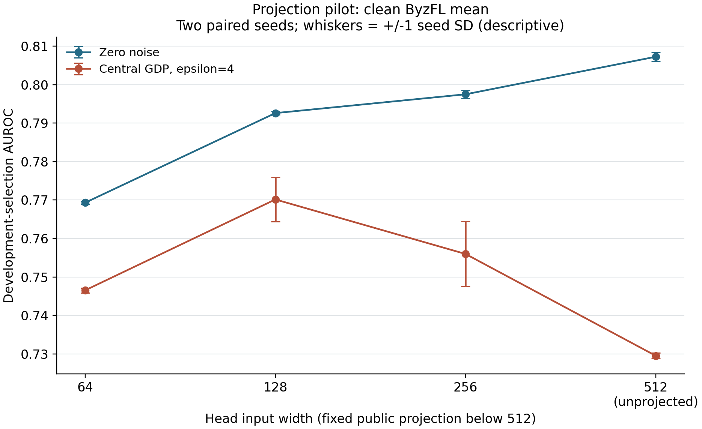
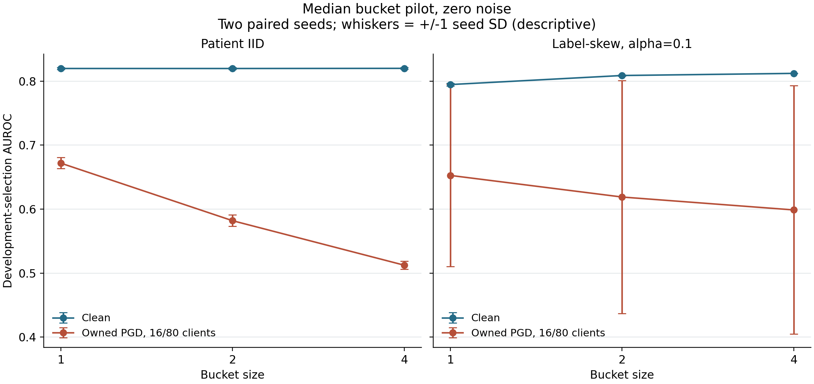

# Measuring Privacy and Robustness Trade-offs in Federated Learning

Anurag Lnu | MS Computer Science | Rochester Institute of Technology

Working report, 26 October 2026. Version 5 incorporates the separately frozen CPU execution extension.

## Abstract

This capstone builds a reproducible experimental path inside FedLearn and measures how representation, aggregation and privacy calibration interact under malicious updates. A browser dashboard, authenticated Spring API and supervised Python worker expose the same coordinator and strategy components used by the platform, while source-bound batch runners retain complete scientific outcomes. Experiments use patient-separated NIH ChestX-ray14 frozen features and simulated whole-patient clients. In a frozen twelve-seed Effusion comparison, projection from 512 to 128 features improved private-clean AUROC by **+0.019176**, with training-seed 95% interval **[+0.011011, +0.027340]**, at a clean no-noise cost of 0.014923. Trimming and released-history centered clipping changed their ranking across conditions. The contribution is an inspectable engineering implementation and conditional evidence for choosing its research baselines. Core privacy/attack evidence uses single-host simulation. A separate 52-cell nonprivate CPU extension completed training across three physical machines with numerical simulator agreement and an end-to-end timing penalty. External-site prediction and a protected end-to-end release remain outside the evidence.

## 1. Problem and contributions

Robust aggregation and differential privacy interact through clipping, sensitivity, noise and optimizer state: a rule that resists an attack can lose clean utility after noise. Which composite mechanism preserves prediction under a declared workload, client unit and adversary?

This work contributes three concrete results. First, it connects controlled experimentation to an operational platform: canonical recipe resolution, persistent authenticated runs, process ownership, cancellation, provenance and explicit partial outcomes. Second, it adds and qualifies pinned ByzFL reducers, a coalition-owned-data attack, projection policies and independent metric/inference checks. Third, it completes a prespecified fresh-seed comparison that separates absolute utility from interaction effects and reports uncertainty for two different targets.

Projected128 is the strongest private research candidate among the four tested policies, conditional on this recipe and cohort. No new robust-private optimization theorem is proposed. Appendices A and B retain historical evidence and development diagnostics.

## 2. Implemented architecture and execution boundary

The React Simulation Lab resolves a recipe before launch, displays actual completed rounds, retains run history, compares compatible terminal runs and downloads projected research records. The Spring Boot API uses cookie authentication, platform roles and PostgreSQL ownership. Server configuration owns the interpreter, data pin and storage paths. Browser inputs cannot choose commands or filesystem locations.

The API persists the run before launch and admits one active worker per application instance. It launches `python -m fedlearn.lab_worker` with a minimal environment and a parent pipe. The worker resolves and revalidates canonical configuration, checks feature integrity and reports atomic progress/execution snapshots. The service supervises the process deadline, drains descendants on termination and reconciles unfinished runs on restart using process identity. Completion requires exit status, matching configuration, requested rounds and qualified evidence; a progress counter alone cannot produce success. Cancellation retains partial evidence. Restart reconciliation is implemented; automatic numerical resume is not.

The simulation driver calls the production `FLCoordinator` and strategy interfaces directly. Clients train sequentially inside one process, with client/round-derived randomness. This exercises aggregation and round bookkeeping while eliding network transport. The ByzFL 0.0.11 adapter normalizes updates, applies server clipping, invokes the selected reducer and calibrates noise. Its private centered policy retains the **released** delta as history rather than an unnoised internal center. It refuses unsupported private combinations, including bucketing, median reduction and multi-iteration centered clipping.

A source-bound batch path supports the larger research matrix. Prospective manifests bind protocol, runtime, feature bundle and resolved configurations before fitting. Runners refuse existing outputs, retain failures and stop later fitting when native/ByzFL anchors fail. Saved-head analysis independently rescores five metrics and exports aggregate results. Patient mappings, features, heads and predictions remain private research artifacts. Path-free exports improve disclosure control; they do not make the complete research transcript differentially private.

Browser acceptance used the authenticated API, PostgreSQL and real Python training. Historical demonstrations completed two three-round runs and retained a stopped 2/20-round run. The Effusion follow-up completed a real three-round private run and reproduced the A7 recipe through the Lab with zero observed per-round AUROC difference and the same final digest. These demonstrate execution and persistence. Inspectable contracts and receipts: [worker](simulation-lab-worker-contract.md), [API](simulation-lab-api-contract.md), [browser evidence](simulation-lab-effusion-browser-verification-2026-10-22.json), and [simulation driver](../../../framework/src/fedlearn/simulation/federation.py).

The original privacy/attack comparison uses simulated patient groups on one host. A separately frozen extension now runs the canonical gRPC client and coordinator across Mac, G14 and Orin, with 3/6/24/80 logical clients. One interpreter per host shares training arrays while preserving independent client state and RNG; at most two fits per host run concurrently. All 52 nonprivate CPU cells completed with full cohorts. Appendix D reports numerical parity and timing, including the observed end-to-end slowdown. Three machines remain three physical failure domains; this is not an institutional federation.

## 3. Workload, methods and privacy model

NIH ChestX-ray14 labels were mined from radiology reports [1]. Effusion is positive when its exact label token occurs; all other labels are negative. Preparation found exact RGB duplicates crossing patients/splits, including conflicting labels. A conservative development quarantine removed 111 images from nine patients. The qualified groups contain 68,650 training images from 22,399 patients, 17,763 validation images from 5,600 patients, and 25,596 official-test images from 2,797 patients.

Effusion validation patients were assigned label-independently to development selection (9,075 images; 2,800 patients) and an internal holdout (8,688 images; 2,800 patients). Validation had already informed the historical task. Finalists reuse selection patients; remediation reopened neither holdout nor official-test inputs, labels, predictions or models.

R0 is frozen ImageNet ResNet-18 with 512 features and a two-output linear head: 1,026 trainable parameters. A fixed public orthonormal projection at seed 20261025 reduces the head to 128 features and 258 parameters. Training-only normalization and the prepared bundle are fixed inputs to the studied update mechanism. The backbone is not fine-tuned. This is binary logistic-head optimization, whose loss is convex in the head parameters; local minima do not explain the observed initialization or policy differences.

The final matrix crosses four policies, two noise settings, two attack settings and twelve seeds, 13001–13012: 192 main cells plus four native anchors. Each uses zero initialization, eighty whole-patient IID clients, full participation, twenty rounds, seven local epochs, batch 256, learning rate 0.03 and outer clip C=0.05. Uniform client weighting differs from image-weighted centralized training. This common recipe compares composite mechanisms, not fully tuned optima.

The coordinator is trusted to see and clip individual updates and release a Gaussian-noised aggregate. Adjacency replaces one simulated client, conditional on fixed preprocessing and assignment. In attacked arms, the protected change is one honest client with coalition identities/data fixed, conditional on released history. Replacing a coalition member can alter several malicious uploads and lacks this single-upload bound. A change to one patient's data within one honest client is a subset of whole-client replacement under those fixed conditions, so the same abstract bound applies; there is no automatic amplification to a smaller ε. This does not qualify an end-to-end patient-private preprocessing, selection or export pipeline, or local privacy against the coordinator.

For N=80 and sixteen trimmed values per tail [2], the per-release sensitivities are:

Mean: Δ = 2C/80. Trim16: Δ = 2C/(80−32) = 2C/48. Centered: Δ = 2 min(C,τ)/80, conditional on released history.

Center_quarter uses τ=0.0125. Gaussian coordinate noise SD is σ = zΔ. With T full-participation releases, Gaussian differential privacy composes as **μ = √T/z** [3]. Calibration to ε=4 and δ=0.00001 at T=20 gives z≈4.8351; an independent normal-CDF calculation checks the trade-off. Mean noise SD is approximately 0.006044, trim noise is 5/3 times larger, and center_quarter noise SD is approximately 0.001511. Matching ε changes both noise amplitude and the update rule. No subsampling amplification is used.

The adversary owns sixteen persistent clients. Owned-data PGD uses their examples and updates plus previously released model/history; it cannot read selection labels or current raw honest updates. It performs twenty ascent steps and three restarts, totaling sixty gradient and sixty-three loss evaluations per round, with step ratio 0.25 and a full-norm negative coalition-mean initialization. In projected128 arms it receives the corresponding projected 128-feature data and matching head. Its loss uses a uniform-mean surrogate, so it is a permitted-information heuristic rather than a reducer-specific worst-case attack. Mandatory server clipping bounds actual reducer inputs despite small reconstruction rounding overshoots.

The primary outcome is projected128 minus mean512 private-clean AUROC. AUROC measures score ranking: higher is better, 0.5 is chance ranking, and it does not specify a clinical operating threshold. The prespecified technical margin is +0.01. A paired t95 interval across twelve seeds conditions on fixed patients; a separate 2,000-draw patient-cluster percentile bootstrap at seed 20261025 holds the twelve fitted head pairs fixed and preserves image weighting. Neither is joint training-and-population uncertainty. Thirty secondary contrasts are descriptive and unadjusted for multiplicity. Average precision, Brier score and sensitivity/specificity at probability 0.5 are also retained.

## 4. Final findings

All 196 planned cells completed: 3,920 full eighty-client rounds, including 1,920 PGD rounds and 98 private cells. The independent execution audit reconciled 150 source files and all 31 paired-seed contrasts, with maximum arithmetic difference 5.6e−17. Native/ByzFL final parameters had numerically zero maximum difference in all four anchor comparisons; this is not a bytewise equality assertion. Every saved head passed five-metric rescoring and independent weighted-AUROC checks.

Table 1 reports every final main-arm mean. Native anchors are excluded. Each entry averages twelve training seeds on the same selection patients; GDP4 denotes the ε=4, δ=0.00001 central mechanism defined above.

| Policy | Clean, no noise | Owned PGD, no noise | Clean, GDP4 | Owned PGD, GDP4 |
| --- | ---: | ---: | ---: | ---: |
| mean512 | 0.807298 | 0.528545 | 0.740361 | 0.551304 |
| projected128 | 0.792375 | 0.761839 | 0.759536 | 0.683331 |
| trim16 | 0.807002 | 0.599442 | 0.678365 | 0.605114 |
| center_quarter | 0.805107 | 0.722725 | 0.666497 | 0.508300 |

The primary gain is **+0.019176**, with approximate paired training-seed t95 interval **[+0.011011, +0.027340]**, SD 0.012850, SE 0.003709 and eleven degrees of freedom. Its lower endpoint exceeds the technical margin by 0.001011. The separate fixed-head patient interval is **[+0.013136, +0.025893]**, with 2,000 valid and zero skipped draws. This meets the conditional technical criterion.

The gain is less than half the two-seed pilot estimate, +0.0406. One final seed favors full width (−0.005253); another gains only +0.000419. Selection optimism may contribute to the shrinkage; it is not an established sole explanation.

Projection costs 0.014923 clean no-noise AUROC and improves attacked points under this PGD. It changes signal, head geometry, clipping and noise jointly. Reduced noise energy alone is not a demonstrated causal explanation. Likewise, center_quarter improves nonprivate attacked utility but has the lowest private attacked point. A noisy previous release may make its center stale or unstable; that is a hypothesis, not a causal finding. Trim16 improves private attacked utility over mean512 while losing private-clean utility. These reversals rule out choosing a default from robustness labels or sensitivity alone.

## 5. Related systems and comparison boundary

| System or method | Relevant capability | Relationship to this study |
| --- | --- | --- |
| ByzFL 0.0.11 [7] | Aggregators, preaggregators and attacks | Reducers executed through the qualified adapter; clipping, private history, accounting and evidence are integration responsibilities. |
| NVIDIA FLARE [8,9] | Orchestration; Opacus sample-DP training; update filters | Documentation/source inspected; no matched FLARE benchmark. Percentile sparsification alone does not supply this client-DP guarantee. |
| SAFE-DSHB [5] | Privacy/robustness/utility analysis and method | Relevant theory; protocol and assumptions were not reproduced as a matched baseline. |
| DP-BREM / DP-BREM+ [6] | Record-level cross-silo privacy; momentum, clipping and added integrity mechanisms | Different privacy unit and transcript; secure summation alone does not validate inputs or generate sufficient honest noise. |
| CafCor [12] | Correlated noise with pairwise secret randomness | A failure of this project's shared-noise design does not refute this separate protocol. |
| Byz-Clip21-SGD2M [10] | Client momentum, clipped error feedback and local noisy messages | Separate protocol-level reproduction needed; not equivalent to replacing a server reducer. |
| LA-LoRA [11] | Low-rank private fine-tuning | Changes the trainable model; not a matched frozen-head comparison. |

Table 2 separates executed components from systems inspected through primary sources.

The one-step released-history center here is not a full reproduction of worker-momentum methods such as Learning from History [13]. Existing tools reduce implementation effort without settling sensitivity, attacker knowledge or matched evaluation. This comparison cannot establish state-of-the-art performance.

## 6. Consolidated validity and release scope

The scientific limit is repeated development-selection use. Fresh seeds assess training variability; they do not provide a fresh cohort or correct prior policy selection. The two reported interval targets also omit joint uncertainty. Weak report-mined labels, undetected near-duplicates, simulated IID clients and a frozen pretrained representation limit transfer to hospitals. Label-skew pilots do not reproduce scanner, institution or temporal shift.

The attack is damaging in its positive control but neither optimal nor exhaustive. Oracle attacks using current honest raw updates are separate nonprivate stress tests: their dependence can break the single-upload client-data argument. A good result against this PGD cannot certify Byzantine robustness in general.

The mathematical update bound does not cover preprocessing, all diagnostics, public experiment seeds, saved models and the cumulative research transcript. Public/shared randomness is not a protected deployment randomness design. Floating-point leakage, observable failures and malicious-input enforcement need separate qualification. Central privacy, local privacy and secure aggregation provide different trust guarantees.

Testing supports specified execution paths, not external validity or proof of complete security. The distributed extension's permitted full-framework run passed 2,403 tests, with fourteen deselected and 80.23% coverage; those are suite totals, not 2,403 newly added capstone tests. Local socket permission failures in the first sandbox run were resolved by the permitted rerun. The earlier intermittent backend admin-login transport failure remains unexplained and is not described as fixed.

## 7. Conclusions and next work

Use projected128 as the next private research baseline for this workload, retain mean512 as the higher clean no-noise reference, and evaluate trimming against the required clean/attacked trade-off. Center_quarter is unsupported as a private default. The engineering result is a working, auditable experiment path that preserves configuration, completion and failure semantics alongside the measurements.

Prioritize a new, independently frozen cohort with a small matched protocol baseline. The CPU extension establishes numerical execution parity but adds end-to-end cost for these short jobs. Profile startup, data staging and steady-round coordination before expanding the systems matrix or making accelerator claims. Secure aggregation, private randomness and malicious-input checks require their own protocol scope. This report does not establish clinical readiness, institutional approval, submission completion or production security.

## Appendix A. Historical findings and evidence chronology

The prospectively frozen any-finding study completed 360 cells and 7,200 rounds. Its ten-seed privacy-by-trimming interaction was +0.002266150 AUROC, t95 interval [0.000704398, 0.003827901]. Absolute private attacked utility was lower for trimming, so the positive interaction alone did not justify a private default.

| Historical condition | Mean AUROC | Trimmed mean AUROC |
| --- | ---: | ---: |
| Clean, no noise | 0.662202 | 0.662033 |
| Sign flip, no noise | 0.648991 | 0.656265 |
| Clean, private ε=4 | 0.646336 | 0.627488 |
| Sign flip, private ε=4 | 0.627389 | 0.618250 |

| Evidence stage | Retained role |
| --- | --- |
| Historical any-finding matrix | Original declared question and cohorts; descriptive wider comparisons. |
| Effusion A1–A23 | Adaptive representation, privacy and attack development. |
| A10 internal holdout | One opening for previously frozen models; published aggregates reused here. |
| Retrospective reanalysis | 173 contrasts from eight pinned summaries; separates patient and seed targets. |
| ByzFL qualification | Four cells and A17 reference reconciliation. |
| Diagnostic pilots | Eighty screen and forty-six nonprivate bucket cells; complete negative results retained. |
| Frozen finalists | 192 main cells plus four anchors on fresh training seeds. |

A10 published clean FedAvg/centralized-convex holdout AUROCs are approximately 0.836/0.835. The difference interval [−0.0021,+0.0044] establishes neither equivalence nor noninferiority. Private ε=8/4/1 recipes gave approximately 0.763/0.715/0.580. At their transferred frozen thresholds, sensitivity was approximately 0.908–0.923 while specificity fell from approximately 0.545 to 0.386/0.296/0.141. Those operating points do not establish general specificity-only privacy costs or clinical triage value.

Subsequent evidence qualified zero initialization and full-participation calibration for the tested recipe, exposed weak original sign-flip controls, and found local-noise integrity and distributed clip-skipping failures. A23's μ/N noise allocation also lacks sufficient unknown honest noise after colluders reveal shares. Original measurements and artifact hashes remain preserved.

## Appendix B. Complete diagnostic pilot AUROC results

The eighty-cell screen and forty-six-cell bucket stage completed all 126 cells and 2,280 iterative rounds. Each arm below has two seeds. The table retains every arm, including native anchors, scalar ERM and reused clean screen references; reused references are not additional fits. Min/max and sample SD describe seeds, not confidence intervals. The [public pilot summary](effusion-diagnostic-pilots-2026-10-25.json) retains all five metrics and individual seed values.

Owned PGD's nonprivate mean damage was 0.2872, exceeding the declared 0.02 gate; original sign flip and full-norm owned sign flip caused only 0.0050/0.0075. Projection128 was selected by private-clean utility. Scalar private ERM uses a distinct one-release strongly convex scalar-head mechanism, finite-iteration sensitivity allowance and intercept regularization; its weak tested utility does not reject all private convex methods.

Bucket diagnostics use the separately selected LR0.1/C1 recipe without privacy. Larger buckets improve some clean skewed points and worsen several attacked points. Mixing heterogeneity and spreading contamination is consistent with the observations, not a uniquely proven explanation. Private bucketing was not qualified.

| Pilot arm | Mean AUROC | Minimum | Maximum | Seed SD |
| --- | ---: | ---: | ---: | ---: |
| mean:native:nonprivate | 0.8073 | 0.8065 | 0.8080 | 0.0011 |
| mean:byzfl:nonprivate | 0.8073 | 0.8065 | 0.8080 | 0.0011 |
| mean:native:private | 0.7295 | 0.7290 | 0.7300 | 0.0007 |
| mean:byzfl:private | 0.7295 | 0.7290 | 0.7300 | 0.0007 |
| center_r0.25_clean:byzfl:nonprivate | 0.8051 | 0.8043 | 0.8058 | 0.0011 |
| center_r0.25_owned_pgd:byzfl:nonprivate | 0.7028 | 0.7020 | 0.7036 | 0.0011 |
| center_r1_clean:byzfl:nonprivate | 0.8073 | 0.8065 | 0.8080 | 0.0011 |
| center_r1_owned_pgd:byzfl:nonprivate | 0.6033 | 0.6005 | 0.6061 | 0.0040 |
| center_r4_clean:byzfl:nonprivate | 0.8073 | 0.8065 | 0.8080 | 0.0011 |
| center_r4_owned_pgd:byzfl:nonprivate | 0.5201 | 0.5184 | 0.5217 | 0.0023 |
| mean_sign_flip_scale_f16:byzfl:nonprivate | 0.8022 | 0.7986 | 0.8058 | 0.0051 |
| mean_owned_sign_flip_f16:byzfl:nonprivate | 0.7998 | 0.7948 | 0.8048 | 0.0071 |
| mean_owned_pgd_f16:byzfl:nonprivate | 0.5201 | 0.5184 | 0.5217 | 0.0023 |
| trim16_clean:byzfl:nonprivate | 0.8070 | 0.8068 | 0.8072 | 0.0003 |
| trim16_owned_pgd:byzfl:nonprivate | 0.5864 | 0.5848 | 0.5880 | 0.0022 |
| mean_k64:byzfl:nonprivate | 0.7693 | 0.7691 | 0.7696 | 0.0003 |
| mean_k128:byzfl:nonprivate | 0.7926 | 0.7923 | 0.7929 | 0.0005 |
| mean_k256:byzfl:nonprivate | 0.7975 | 0.7968 | 0.7982 | 0.0010 |
| erm_l0.01:scalar:nonprivate | 0.7843 | 0.7842 | 0.7843 | 0.0001 |
| erm_l0.1:scalar:nonprivate | 0.7691 | 0.7690 | 0.7691 | 0.0001 |
| erm_l1:scalar:nonprivate | 0.7557 | 0.7556 | 0.7559 | 0.0002 |
| center_r0.25_clean:byzfl:private | 0.6714 | 0.6669 | 0.6760 | 0.0065 |
| center_r0.25_owned_pgd:byzfl:private | 0.5423 | 0.5096 | 0.5751 | 0.0463 |
| center_r1_clean:byzfl:private | 0.5604 | 0.5586 | 0.5622 | 0.0026 |
| center_r1_owned_pgd:byzfl:private | 0.5302 | 0.5091 | 0.5514 | 0.0299 |
| center_r4_clean:byzfl:private | 0.7289 | 0.7280 | 0.7298 | 0.0013 |
| center_r4_owned_pgd:byzfl:private | 0.5967 | 0.5349 | 0.6585 | 0.0874 |
| mean_sign_flip_scale_f16:byzfl:private | 0.6691 | 0.6680 | 0.6701 | 0.0015 |
| mean_owned_sign_flip_f16:byzfl:private | 0.6563 | 0.6555 | 0.6572 | 0.0012 |
| mean_owned_pgd_f16:byzfl:private | 0.5963 | 0.5335 | 0.6591 | 0.0888 |
| trim16_clean:byzfl:private | 0.6586 | 0.6525 | 0.6647 | 0.0086 |
| trim16_owned_pgd:byzfl:private | 0.6136 | 0.5888 | 0.6383 | 0.0350 |
| mean_k64:byzfl:private | 0.7465 | 0.7461 | 0.7470 | 0.0006 |
| mean_k128:byzfl:private | 0.7702 | 0.7661 | 0.7742 | 0.0058 |
| mean_k256:byzfl:private | 0.7560 | 0.7500 | 0.7620 | 0.0085 |
| erm_l0.01:scalar:private | 0.5345 | 0.4295 | 0.6396 | 0.1485 |
| erm_l0.1:scalar:private | 0.5434 | 0.4405 | 0.6463 | 0.1455 |
| erm_l1:scalar:private | 0.5483 | 0.4470 | 0.6496 | 0.1433 |
| median_recipe_tight:byzfl:nonprivate | 0.8063 | 0.8061 | 0.8065 | 0.0003 |
| median_recipe_loose:byzfl:nonprivate | 0.8198 | 0.8186 | 0.8210 | 0.0017 |
| median_b1_iid_pgd_f4:byzfl:nonprivate | 0.8119 | 0.8102 | 0.8135 | 0.0023 |
| median_b1_iid_pgd_f16:byzfl:nonprivate | 0.6719 | 0.6658 | 0.6780 | 0.0087 |
| median_b1_iid_oracle_fang16:byzfl:nonprivate | 0.7668 | 0.7641 | 0.7695 | 0.0038 |
| median_b2_iid_clean:byzfl:nonprivate | 0.8198 | 0.8186 | 0.8210 | 0.0017 |
| median_b2_iid_pgd_f4:byzfl:nonprivate | 0.8101 | 0.8078 | 0.8125 | 0.0033 |
| median_b2_iid_pgd_f16:byzfl:nonprivate | 0.5819 | 0.5756 | 0.5882 | 0.0089 |
| median_b2_iid_oracle_fang16:byzfl:nonprivate | 0.6852 | 0.6645 | 0.7058 | 0.0292 |
| median_b4_iid_clean:byzfl:nonprivate | 0.8200 | 0.8192 | 0.8208 | 0.0011 |
| median_b4_iid_pgd_f4:byzfl:nonprivate | 0.8053 | 0.8019 | 0.8087 | 0.0048 |
| median_b4_iid_pgd_f16:byzfl:nonprivate | 0.5123 | 0.5077 | 0.5169 | 0.0065 |
| median_b4_iid_oracle_fang16:byzfl:nonprivate | 0.6566 | 0.6532 | 0.6600 | 0.0048 |
| median_b1_a0p1_clean:byzfl:nonprivate | 0.7947 | 0.7931 | 0.7963 | 0.0022 |
| median_b1_a0p1_pgd_f4:byzfl:nonprivate | 0.7827 | 0.7800 | 0.7855 | 0.0039 |
| median_b1_a0p1_pgd_f16:byzfl:nonprivate | 0.6527 | 0.5518 | 0.7535 | 0.1426 |
| median_b1_a0p1_oracle_fang16:byzfl:nonprivate | 0.6313 | 0.6078 | 0.6548 | 0.0332 |
| median_b2_a0p1_clean:byzfl:nonprivate | 0.8089 | 0.8080 | 0.8097 | 0.0012 |
| median_b2_a0p1_pgd_f4:byzfl:nonprivate | 0.7964 | 0.7939 | 0.7990 | 0.0036 |
| median_b2_a0p1_pgd_f16:byzfl:nonprivate | 0.6189 | 0.4901 | 0.7477 | 0.1821 |
| median_b2_a0p1_oracle_fang16:byzfl:nonprivate | 0.4342 | 0.4277 | 0.4407 | 0.0092 |
| median_b4_a0p1_clean:byzfl:nonprivate | 0.8122 | 0.8121 | 0.8123 | 0.0001 |
| median_b4_a0p1_pgd_f4:byzfl:nonprivate | 0.7971 | 0.7964 | 0.7977 | 0.0010 |
| median_b4_a0p1_pgd_f16:byzfl:nonprivate | 0.5987 | 0.4614 | 0.7360 | 0.1942 |
| median_b4_a0p1_oracle_fang16:byzfl:nonprivate | 0.4115 | 0.3983 | 0.4247 | 0.0186 |
| median_b1_iid_clean:byzfl:nonprivate | 0.8198 | 0.8186 | 0.8210 | 0.0017 |

## Appendix C. Reproduction and evidence checks

Reproduction requires the qualified NIH train/selection feature bundle and matching preparation hashes; public aggregates alone are insufficient to rerun training. Use Python 3.12, manifest-pinned runtime versions and isolated ByzFL 0.0.11. Preserve source snapshots: qualification 016677f, screen 8ea4b7d, buckets 5940d13 and finalists 1a9f0ef. Each stage has a zero-fitting preflight before checkpoint-bound execution into a fresh directory.

The [reproduction guide](remediation-reproduction-guide-2026-10-25.md) documents exact entry points. `repro/run_effusion_finalists.py` validates the parent pilots and manifests; `repro/analyze_effusion_finalists.py` rescores retained heads without fitting; `repro/plot_remediation_results.py` consumes public summaries. Source, runtime, bundle and configuration mismatches are refusals to investigate, not checks to bypass. Holdout and official-test data are excluded.

Pilot audits reconciled 140 source hashes and independently checked AUROC/AP, with maximum metric difference below 2.3e−16. The phase receipts retain outcome accounting, source identities and scoped verification. Remediation totals 326 cells and 6,280 iterative rounds including qualification; older studies remain distinct.

## Appendix D. Three-host CPU execution follow-up

The separately frozen 26 October extension completed 52 nonprivate cells, 320 full-cohort rounds and 13,180 client fits/acknowledged uploads. Its 48 systems cells cross 3/6/24/80 logical clients, mean512/projected128, three new paired seeds and Mac-only/three-host placement for five rounds. Four twenty-round 80-client anchors replay historical seed 13001. They reuse pinned selection-stage simulator heads, not new confirmation data. Mac retains selection; remote hosts receive assigned training rows only.

The canonical recipe is unchanged: zero head, SGD 0.03, seven local epochs, batch 256, C=0.05 and uniform reduction in logical-ID order. Two fits per host allow two total on Mac-only and six total on three hosts; only three can be active in the three-client case. This compares adding host resources, not holding total concurrency fixed. Actual interpreter versions, source, execution order and every input commitment were checkpointed at `8ac59c4` before medical fitting.

All 26 placement pairs met the prospective 1e-5 maximum absolute parameter tolerance; the observed maximum was 2.9802322387695312e-8. Mac-only anchors exactly matched their stored simulator head values. The maximum three-host/historical difference was 3.725290298461914e-9. All 52 final heads passed independent loss/AUROC rescoring. The maximum placement AUROC difference was 2.494283103393613e-7. The audit also reconciled raw journals, exact fits/uploads, seven-epoch partial batches, example counts and every evaluated aggregate, then regenerated the full public analysis.

Table 4 gives median five-round elapsed times and median paired timing ratios over three seeds. Ratios are Mac-only divided by three-host time; above 1 favors three hosts. The paired median ratio need not equal the ratio of separately printed medians. Anchors are excluded.

| Training method | Logical clients | Mac-only median s | Three-host median s | Median whole-cell ratio | Median steady-round ratio |
| --- | ---: | ---: | ---: | ---: | ---: |
| mean512 | 3 | 13.51 | 32.25 | 0.419 | 1.134 |
| mean512 | 6 | 13.34 | 33.48 | 0.392 | 0.945 |
| mean512 | 24 | 13.34 | 35.84 | 0.370 | 0.864 |
| mean512 | 80 | 13.37 | 35.81 | 0.367 | 0.921 |
| projected128 | 3 | 13.40 | 26.28 | 0.510 | 1.131 |
| projected128 | 6 | 13.36 | 27.50 | 0.478 | 1.011 |
| projected128 | 24 | 13.30 | 28.12 | 0.468 | 0.873 |
| projected128 | 80 | 13.10 | 28.81 | 0.455 | 0.927 |

Every five-round pair took longer end to end on three hosts: 1.87–2.93 times Mac-only time. Every three-client pair improved steady-round time, while every 24/80-client pair worsened it. Six-client projected128 was mixed. The experiment did not isolate polling, transport, initialization or background work as the cause. Stationary production data would not necessarily repeat this protocol's per-cell staging cost.

Maximum client-process RSS across cells was 626.7 MiB on Mac, 413.6 MiB on G14 and 474.6 MiB on Orin; the coordinator is separate. Communication counts are training-RPC protobuf messages, including repeated downloads, and exclude registration, heartbeats, framing and SSH. Serialization cost is not isolated. Background workloads remained active. Five-round utility is an execution diagnostic rather than the original primary endpoint; three machines do not represent eighty independent devices. This extension does not qualify GPU execution, private distributed training, host-compromise resistance or hospital deployment.

The reviewed implementation passed 2,403 framework tests (80.23% coverage), 802 runtime tests and 17 preparation/supervisor tests. Seven postprocessing tamper/audit regressions passed. See the [protocol](multihost-protocol-2026-10-26.md), [aggregate results](multihost-results-2026-10-26.json), [verification](multihost-verification-2026-10-26.json) and [reproduction instructions](multihost-reproduction.md). Full timing, memory and communication interpretation is in the [results note](multihost-results-2026-10-26.md).

## References

- [1] Wang et al. ChestX-ray8 and ChestX-ray14 appendix. https://arxiv.org/html/1705.02315v5
- [2] Yin et al. Byzantine-Robust Distributed Learning: Towards Optimal Statistical Rates. https://proceedings.mlr.press/v80/yin18a.html
- [3] Dong, Roth and Su. Gaussian Differential Privacy. https://arxiv.org/abs/1905.02383
- [4] Guerraoui et al. Differential Privacy and Byzantine Resilience in SGD: Do They Add Up? https://arxiv.org/abs/2102.08166
- [5] Allouah et al. On the Privacy-Robustness-Utility Trilemma in Distributed Learning. https://proceedings.mlr.press/v202/allouah23a.html
- [6] Gu, Li and Xiong. DP-BREM. https://www.usenix.org/conference/usenixsecurity25/presentation/gu-xiaolan
- [7] ByzFL documentation. https://byzfl.epfl.ch/
- [8] NVIDIA FLARE differential privacy documentation. https://nvflare.readthedocs.io/en/2.9.0/user_guide/admin_guide/security/differential_privacy.html
- [9] NVIDIA FLARE PercentilePrivacy API. https://nvflare.readthedocs.io/en/main/apidocs/nvflare.app_common.filters.percentile_privacy.html
- [10] Islamov et al. Byzantine-Robust and Differentially Private Federated Optimization under Weaker Assumptions. https://arxiv.org/html/2603.23472v1
- [11] LA-LoRA, ICLR 2026. https://proceedings.iclr.cc/paper_files/paper/2026/hash/34b13425b5ba8ad05d97b0043df52ed3-Abstract-Conference.html
- [12] Allouah, Guerraoui and Stephan. Towards Trustworthy Federated Learning with Untrusted Participants. https://proceedings.mlr.press/v267/allouah25a.html
- [13] Karimireddy, He and Jaggi. Learning from History for Byzantine Robust Optimization. https://proceedings.mlr.press/v139/karimireddy21a.html
