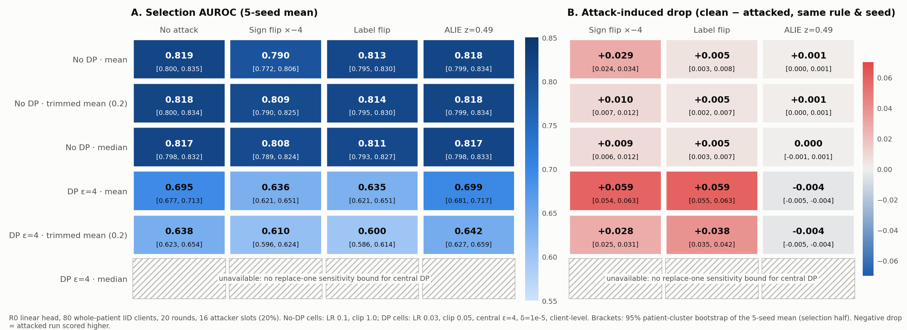

# Effusion R0 bounded attack study (A9): result

22 October 2026. Executes amendment A9, which was committed before the run. Everything
is on the selection half; the holdout is untouched.

**Integrity:** all 100 cells were usable. There were no refusals and no non-finite
runs, and every attacked run had exactly 16 attacker slots.

The figure is rendered by `repro/plot_effusion_attacks.py` from the hash-pinned record. The
plotted values are in `figures/effusion-attack-heatmaps-v1-values.json`.

## Robust rules against plain mean

Same seed and condition; paired patient bootstrap (2,000 resamples, seed 20261028).

| Setting | Condition | Trimmed mean − mean | Median − mean |
| --- | --- | --- | --- |
| No DP | No attack | −0.0003 [−0.0010, +0.0004] | −0.0021 [−0.0032, −0.0011] |
| No DP | Sign flip ×−4 | **+0.0190 [+0.0166, +0.0214]** | **+0.0178 [+0.0152, +0.0205]** |
| No DP | Label flip | +0.0004 [−0.0019, +0.0029] | −0.0021 [−0.0046, +0.0007] |
| No DP | ALIE | −0.0004 [−0.0009, +0.0002] | −0.0013 [−0.0022, −0.0005] |
| DP ε=4 | No attack | **−0.0564 [−0.0601, −0.0522]** | unavailable |
| DP ε=4 | Sign flip ×−4 | −0.0259 [−0.0285, −0.0231] | unavailable |
| DP ε=4 | Label flip | −0.0355 [−0.0384, −0.0322] | unavailable |
| DP ε=4 | ALIE | −0.0563 [−0.0599, −0.0521] | unavailable |

## Findings

1. **Without DP, trimmed mean is close to a free insurance policy.** It costs nothing
   measurable when nobody attacks (−0.0003). It cuts the sign-flip loss from 0.029 to
   0.010, recovering about two thirds of the damage. Median is similar under attack but
   has a small clean cost (−0.002).
2. **With central DP at ε 4, trimmed mean is worse than plain mean in every condition,
   attacked or not.**
   - Its replace-one sensitivity is 2C/(n − 2k) = 2C/48, against 2C/80 for the mean. That
     needs about 1.67× the noise, which costs 0.056 AUROC clean. That is more than the
     attacks it defends against cost the plain mean here: 0.059 for sign flip and label
     flip.
   - Under DP, plain mean scores higher than trimmed mean under every condition tested,
     clean and attacked.
3. **Attacks hurt more under DP with the small binding DP clip.**
   - Sign flip and label flip each cost the mean 0.059 under DP, against 0.029 and 0.005
     without DP.
   - Every client, honest or malicious, is clipped to the same 0.05 norm, so 20% of
     slots pushing the wrong way carry a larger share of a smaller signal.
4. **ALIE at its published bound (z = 0.49) did nothing measurable** without DP. Under
   DP it slightly *raised* AUROC (−0.004 drop, both rules). This is reported as observed;
   a stronger or adaptive ALIE was not run.

## Platform guidance this supports

For this workload class only (a linear head over frozen features, IID whole-patient
clients, 20% attackers), not a universal rule:
- **No DP, attackers plausible:** prefer `robust` with trimmed mean (trim 0.2). It is
  effectively free when there is no attack.
- **Central DP required:** use the DP mean (`DPFedAvg`). Do not combine robust trimming
  with central DP unless the attack threat is far larger than tested. The platform already
  refuses DP on the robust strategy (`5fad502`), and this evidence supports that.
- **Expect DP to amplify the damage from poisoning.** Pair it with client authentication
  (the existing connection token) rather than relying on aggregation to absorb attackers.

**Limits:** one attacker fraction; non-adaptive attacks apart from ALIE's construction;
client-level privacy; simulated clients; selection half only. Absolute values are
development estimates; only the §8 holdout is unbiased.

Private evidence: `summary.json`
`1530b753892216ec9a140610916854315c6d40b3628ed4099151d6afde724568`.
