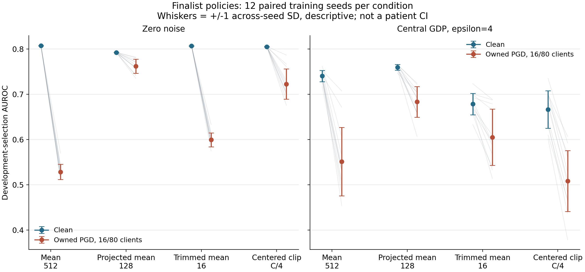
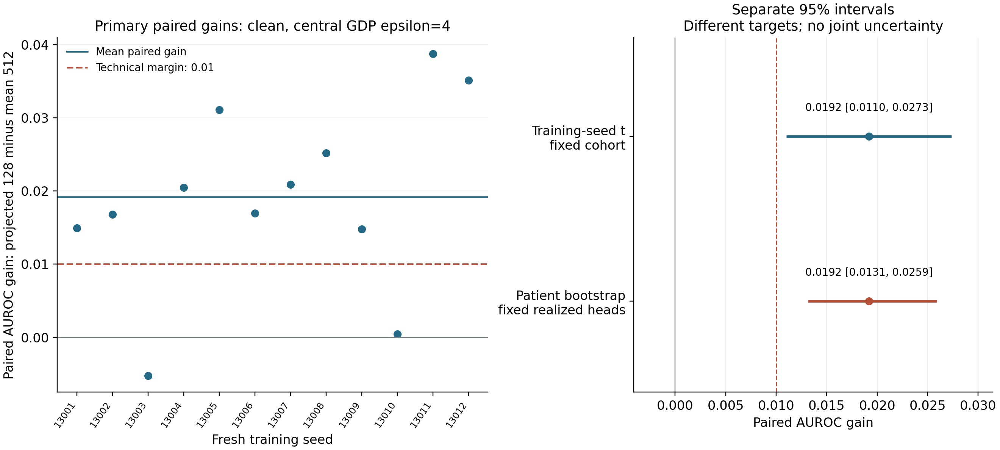

# Fresh-seed finalist comparison: result

25 October 2026. Complete under prospective local checkpoint 1a9f0ef. Frozen selected policies on repeatedly used development-selection cohort; separate conditional training-seed and realized-head patient intervals; no joint uncertainty, untouched-cohort confirmation, clinical claim, family-wide discovery or whole-study DP claim.

All 196 cells completed, including 192 main cells and four native anchors: 3,920 full eighty-client rounds. Every saved head passed five-metric rescoring and independent weighted-AUROC checks. Native/ByzFL parameter differences were exactly zero in all four comparisons. A separate audit verified all 150 frozen/archive/live source files, 98 private cells and 1,920 PGD rounds, and reproduced all 31 paired-seed contrasts with maximum difference 5.6e-17.

The primary private-clean mean gain is **+0.019176 AUROC**, with approximate training-seed t95 interval **[+0.011011, +0.027340]**, SD 0.012850, SE 0.003709, and 11 degrees of freedom. This meets the frozen +0.01 technical-margin criterion, but its lower endpoint clears that margin by only 0.001011. The separate fixed-head patient-cluster interval is **[+0.013136, +0.025893]**, from 2,000 valid draws with zero skipped draws. It is not a joint interval or an independent validation of policy selection.

The gain is less than half the two-seed pilot estimate (+0.0406), and its seed SD is about twice the pilot SD. One fresh seed favored the full-width mean (gain -0.00525), and another gave only +0.00042. The pilot effect did not carry over at its original magnitude; the fixed twelve-seed comparison materially changed the estimate. These observations do not identify selection optimism as the sole cause of the shrinkage.

| Finalist policy | Clean, no noise | PGD, no noise | Clean, GDP4 | PGD, GDP4 |
| --- | ---: | ---: | ---: | ---: |
| mean512 | 0.8073 | 0.5285 | 0.7404 | 0.5513 |
| projected128 | 0.7924 | 0.7618 | 0.7595 | 0.6833 |
| trim16 | 0.8070 | 0.5994 | 0.6784 | 0.6051 |
| center_quarter | 0.8051 | 0.7227 | 0.6665 | 0.5083 |

Projection had the highest observed attacked mean among these four policies, both without noise and with GDP4. Its private attacked gain over mean512 was +0.1320, with a descriptive unadjusted seed interval [+0.0829,+0.1812]. This is evidence for the tested projected mechanism under this mean-surrogate attack; it is not a worst-case robustness guarantee or an exhaustive best-method result. Projection also lost 0.0149 AUROC in the clean no-noise condition, so it is not an unconditional default.

Trimming lost 0.0620 private-clean AUROC relative to mean512, yet gained 0.0538 in the private attacked condition, descriptive seed interval [+0.0330,+0.0747]. The earlier blanket preference for mean under privacy therefore does not extend to this qualified attack/recipe. Center_quarter improved nonprivate attacked utility but had private means 0.6665 clean and0.5083 attacked; its smaller formal sensitivity did not deliver better private utility. All secondary intervals are unadjusted, and direct all-method superiority was not the prespecified primary test.

Attacked privacy protects one honest client with fixed coalition identities/data conditional on released history. Coalition-member replacement and whole-study DP exports are unqualified. No raw holdout or official-test access occurred.

See [aggregate results](effusion-finalists-2026-10-25.json), [all contrasts](effusion-finalists-2026-10-25-contrasts.csv), [scoring audit](effusion-finalists-2026-10-25-scoring-audit.json) and [Phase4 receipt](phase-4-verification-2026-10-25.json).
