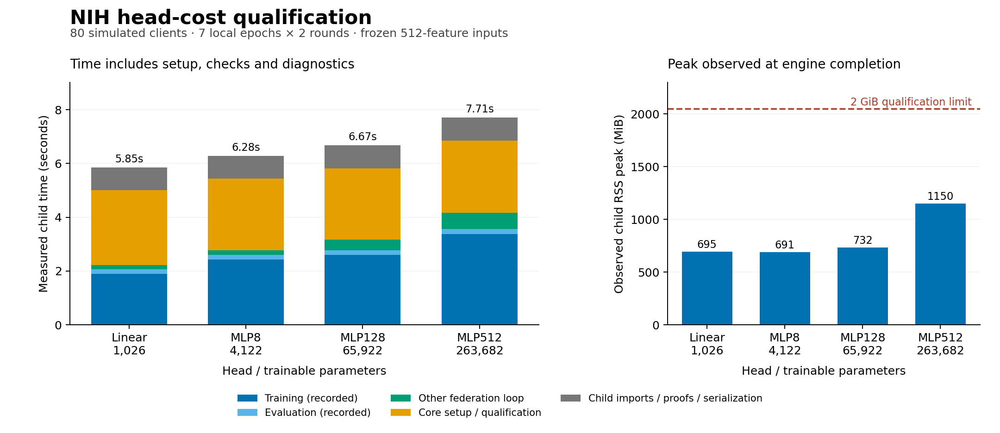

# NIH four-head cost qualification

19 October 2026. Exploratory resource qualification under the
[prospectively committed protocol](nih-head-cost-probe-protocol.md).
All four declared cells qualified; no failure, timeout, omitted cell or retry.
Official-test classifier performance remains unseen.

## What this establishes

The linear, MLP8, MLP128 and MLP512 heads all completed the fixed eighty-client,
two-round execution contract within the declared time and observed-memory gates.
This supports including the proposed head sizes in a bounded subsequent study.
It does **not** establish convergence, an optimal head or a privacy/robustness result.

The largest head has 257 times the trainable parameters and 248.245 times the
modeled payload of the linear head. Its measured child time is only 1.317 times
larger in this short probe. Much of the child duration is outside the federation
loop; parameter/FLOP ratios alone are insufficient to predict elapsed time.
The largest observed process-memory peak is 1,149.66 MiB, below the 2 GiB gate.
These are cached-feature CPU simulation measurements on one machine, not physical
phone performance or a general hardware scaling law.

[Vector figure](figures/nih-head-cost-probe-v1.svg).

## Protocol and executed source

- Protocol was committed at `aa8ae48`, before this runner and every real cell.
- Reviewed runner/tests were committed at `7a373cb`, before execution. Its
  [source](../../../framework/benchmarks/nih_head_cost_probe.py) calls the
  [core execution wrapper](core-execution-qualification.md) and independently
  requalifies returned records in the parent.
- Protocol document SHA-256:
  `a2235ba6cba2c9624c9cf4400baec45b879a79949cbf0436e2237ce0df0a1db5`.
- Qualified feature-report SHA-256:
  `6c9e6969c6fd762156ef2246323fbdbc5e9cb272c9910a8b1c9b691ab33783fd`.

Every cell uses the same frozen 512-feature representation, whole-patient
allocation, natural prevalence, seed 20261019 and validation split. All eighty
clients participate in each of two rounds, with seven local epochs, SGD LR 0.003,
batch size 256, mean aggregation, C 0.4 clipping, no server optimizer, no DP or attackers.
Children execute sequentially on CPU with four threads; no regression suite ran
concurrently. Fixed execution order, ordinary background load, caches and thermal
state were not independently controlled. There is one run per head, not a
replicated timing benchmark.

## Measured timing and memory

| Head | Parameters | Child elapsed s | Full core call s | Federation loop s | Observed peak MiB |
| --- | ---: | ---: | ---: | ---: | ---: |
| Linear | 1,026 | 5.854 | 5.010 | 2.220 | 695.19 |
| MLP8 | 4,122 | 6.280 | 5.435 | 2.778 | 690.88 |
| MLP128 | 65,922 | 6.674 | 5.823 | 3.164 | 732.20 |
| MLP512 | 263,682 | 7.710 | 6.855 | 4.160 | 1,149.66 |

The three durations have different scopes:

1. **Child elapsed** covers interpreter/import startup, source checks, core call,
   record serialization and completion proofs.
2. **Full core call** is measured around `run_core`: recipe preflight, engine
   cache validation/loading, partitioning, model/strategy setup, federation loop
   and postflight qualification. It excludes subsequent record/proof writing.
3. **Federation loop** is the existing `meta.wall_seconds` field, measured inside
   `SimulatedFederation.run`. Earlier reports called this engine time; their
   labels are now clarified without changing the retained numerical records.

Recorded training stages total 1.893/2.429/2.597/3.377 seconds respectively;
evaluation stages total 0.180/0.178/0.177/0.190 seconds. The rest of the loop includes
model construction, aggregation, diagnostics/counterfactual previews and other
orchestration. These stage timers do not isolate pure training kernels.
Work outside the loop is 62.08% of the linear child's time and 46.05% of MLP512's.

All child executions total **26.518940 seconds**, below the 600-second budget;
parent control and verification total **3.192010 seconds**, for a measured probe
interval of 29.710950 seconds. Parent interpreter/import startup and the final
summary write lie outside that interval. Every child is below its 300-second
timeout. Parent control overhead was not charged to the child budget.

RSS comes from the OS process high-water mark sampled at engine completion,
before the wrapper's final qualification and record/proof serialization. It is
per child, excludes the parent, and is not a measurement of whole-machine memory
or a complete process tree. The 2 GiB criterion is a post-run observed-value gate,
not an OS-enforced memory cap. Longer runs and late housekeeping peaks remain
unqualified by this two-round measurement.

## Modeled communication and arithmetic

| Head | One serialized model, bytes | Payload each direction over 2 rounds, MB | Recorded client matmul FLOPs, billions |
| --- | ---: | ---: | ---: |
| Linear | 4,250 | 0.680000 | 3.936666 |
| MLP8 | 16,783 | 2.685280 | 15.838928 |
| MLP128 | 263,996 | 42.239360 | 253.422848 |
| MLP512 | 1,055,043 | 168.806880 | 1,013.691392 |

MB here means 1,000,000 bytes. Each direction contains 160 model transfers:
80 clients × 2 rounds. Figures include the actual uncompressed float32 tensor
header/data sizes used by the simulator. They exclude physical packet/protocol
overhead, cached backbone distribution, raw images and feature preparation.
Neither network throughput nor phone battery cost was measured.

The engine instruments one training call per client and reuses that count for
subsequent calls with the same data/shape/epoch recipe. Independent arithmetic
agrees with every recorded round and total. This first-participation instrumentation
also contributes timing overhead; multiplying two-round time by ten would repeat
that overhead in the estimate. MLP512 has 257.5 times the linear head's matmul FLOPs, while its
federation loop is 1.874 times as long here. FLOPs are an arithmetic count; this
short experiment does not isolate why elapsed time scales differently. No
twenty-round runtime estimate is promoted to a measured result.

## Learning diagnostics and clipping limits

| Head | Final validation AUROC | Loss | Balanced accuracy | ECE |
| --- | ---: | ---: | ---: | ---: |
| Linear | 0.616653 | 0.659285 | 0.574008 | 0.011785 |
| MLP8 | 0.599990 | 0.672583 | 0.500341 | 0.044003 |
| MLP128 | 0.610149 | 0.669382 | 0.502426 | 0.049391 |
| MLP512 | 0.635694 | 0.662512 | 0.521973 | 0.041945 |

These are fourteen nominal image passes, compared with 140 in the established
[linear baseline](nih-schedule-pilot-v3-report.md). In particular, MLP8 and MLP128
have balanced accuracy close to chance at this short operating point. Passing
resource qualification does not make them useful classifiers. The protocol had
no utility threshold or head selection; all outcomes are retained and no head is
chosen from these numbers. Larger-head learning/privacy contrasts still require
their own matched no-DP controls under the final study recipe.

C 0.4 clips no upload in any of these eight rounds: clip rate 0, mean shrink 1.
Recorded mean honest-update norms range 0.018919–0.058413. This does not identify
an optimal clipping bound or prove attack resistance. The final protocol must
predeclare clipping and noise calibration; a loose bound with clean-data utility
is not evidence that its DP noise will preserve that utility.

## Practical decisions for FedLearn

| Decision | Evidence and action | Limit |
| --- | --- | --- |
| Retain the four-head study option | All four sizes pass the declared short execution/resource gate; budget subsequent matched cells explicitly | Two rounds do not establish long-run stability or learning readiness |
| Show payload costs separately from runtime | MLP512 costs 168.807 MB each direction versus 0.680 MB for linear in this simulation of 80 clients and two rounds | Payload estimates omit backbone/data distribution and physical transport |
| Keep timing scopes separate | Store child elapsed, full core call and federation-loop durations; report setup/check/diagnostic costs | One fixed-order sample per head supports resource planning, not a performance scaling law |
| Keep model size secondary to the validated primary comparison | Linear has the separate three-seed full-length baseline; larger heads need matched controls | No best head or dimension-only causal effect is selected here |
| State clipping selection explicitly | C 0.4 was inactive throughout this clean probe | Noise/robustness effects remain unmeasured and cannot be inferred from zero clipping |

## Verification and retained evidence

Before training, 29 focused tests and the full framework suite passed:
**1,918 passed, 14 deselected, 81.60% coverage**, 188.35 seconds, with unhandled thread
exceptions treated as errors. Review found the loop/full-call timing distinction
and missing prospective configuration hashes. Both were reproduced by failing
tests and corrected before commit and real execution. The timing regression adds
a controlled setup delay to the actual engine and proves the full-call timer
includes work excluded by the loop timer.

A separate checker imports no runner, configuration, partition or metric helpers.
It verified 144 committed source/protocol fingerprints, both per-child loaded-source
proof phases, all configuration hashes, cache payload hashes, all eighty patient
allocations and their assignment digest, complete schema 2 participation across
eight rounds, independent model/serialization/FLOP arithmetic, artifact hashes,
timing totals and resource limits. Confusion rates were reconciled against known
validation class counts; AUROC was not independently recomputed from logits.
The PNG/SVG cost figure uses those reconciled records and was visually inspected.

Private evidence retains all four resolved configs, protocol/index/summary,
complete records, logs and start/end source proofs. Historical pilots, raw data
and metric versions remain preserved. No official-test classifier evaluation,
DP/attack contrast, physical-device result or final confirmatory result is added
by this qualification.
