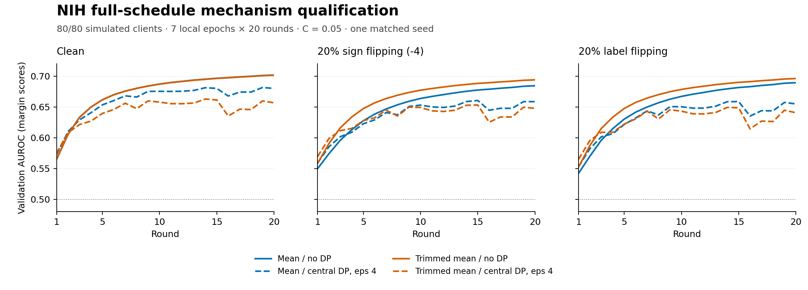

# NIH full-schedule mechanism qualification v1

20 October 2026. Exploratory validation evidence under the
[prospective twelve-cell protocol](nih-mechanism-qualification-v1-protocol.md).
All twelve cells and 240 rounds qualified; no failure, timeout, omitted cell or retry.
Official-test classifier performance remains unseen.

## Verdict

The complete real-data execution path works under this declared recipe: full
accepted cohorts, own-data/update attackers, central Gaussian noise and composed
accounting. This is execution and one-seed validation evidence, not a completed
confirmatory study or proof of convergence, clinical usefulness or private research
logs.

The useful exploratory finding is a trade-off: trimmed mean improves attacked
AUROC over mean without DP, but has lower AUROC with DP in all three conditions.
At the same epsilon and clipping bound its sensitivity and per-coordinate Gaussian
noise are 5/3 as large. The observations are consistent with a robustness/noise
trade-off, but one seed cannot isolate all causes or support a general ranking.

[Vector figure](figures/nih-mechanism-qualification-v1.svg).

## Prospective identity and common recipe

The protocol was committed at `8d76527` before source and real runs; its document
is dated 19 October, while execution completed on 20 October. The reviewed runner
and tests were committed at `4bc8cee` before launch. Protocol SHA-256:
`f59c9de1e57d222c79c68a7897ef9b2769aa547f0d0148a72ed6b97500ed5857`.

The [runner](../../../framework/benchmarks/nih_mechanism_qualification.py) used the
qualified feature report
`6c9e6969c6fd762156ef2246323fbdbc5e9cb272c9910a8b1c9b691ab33783fd`:
frozen pretrained ResNet-18, 512 features, linear head with 1,026 parameters,
whole-patient IID allocation, natural prevalence and validation `margin_v2`.
All 80 clients were accepted in each of 20 rounds, seven local epochs per round,
SGD LR 0.003, batch 256, no server optimizer/proximal term, CPU four threads.
Base seed 20261022 and all resolved streams are matched across the twelve cells.
The same sixteen attacker slots are used across both attacks and all their cells.
The initial pre-clipping/pre-noise upload digest matches within each four-cell
condition; subsequent treatment trajectories differ.

C = 0.05 was fixed before these outcomes, informed by earlier clean-upload mean
norms and inactive C = 0.4. It is not an optimized quantile or universally useful
bound. Sign flipping multiplies each attacker's own update by -4 before common
clipping. Label flipping reverses each attacker's own binary labels. Neither reads
another client's raw current update. Mean and coordinate-wise trimmed mean
(trim ratio 0.2) each have matched clipped no-DP and central-DP controls.

## All final-round outcomes

DP rows use epsilon 4, delta 0.00001, replace-one simulated-client adjacency and
no subsampling credit. No-DP rows have zero noise but the same clipping/rule.

| Condition | Rule | DP | AUROC | Loss | ECE |
| --- | --- | --- | ---: | ---: | ---: |
| Clean | Mean | None | 0.701712 | 0.619855 | 0.014911 |
| Clean | Mean | Central | 0.680021 | 0.634472 | 0.013485 |
| Clean | Trimmed mean | None | 0.701434 | 0.620018 | 0.013436 |
| Clean | Trimmed mean | Central | 0.656694 | 0.658769 | 0.047234 |
| Sign flip | Mean | None | 0.684430 | 0.630303 | 0.016939 |
| Sign flip | Mean | Central | 0.658633 | 0.654859 | 0.017652 |
| Sign flip | Trimmed mean | None | 0.693978 | 0.624716 | 0.017128 |
| Sign flip | Trimmed mean | Central | 0.647719 | 0.669354 | 0.053515 |
| Label flip | Mean | None | 0.689313 | 0.633018 | 0.049038 |
| Label flip | Mean | Central | 0.654882 | 0.649439 | 0.013169 |
| Label flip | Trimmed mean | None | 0.696071 | 0.625596 | 0.034360 |
| Label flip | Trimmed mean | Central | 0.640601 | 0.666635 | 0.044901 |

Default operating point is the existing class argmax. Finding recall is not
80% recall; no threshold was selected or transferred in this qualification.
Clipped percentage below is the mean across all twenty full-cohort rounds,
including attacker uploads, not an honest-client-only statistic.

| Condition | Rule | DP | Balanced accuracy | Finding recall | Specificity | Accuracy | Clipped % |
| --- | --- | --- | ---: | ---: | ---: | ---: | ---: |
| Clean | Mean | None | 0.635697 | 0.463855 | 0.807539 | 0.663007 | 5.125 |
| Clean | Mean | Central | 0.626225 | 0.492905 | 0.759545 | 0.647413 | 5.312 |
| Clean | Trimmed mean | None | 0.634620 | 0.461312 | 0.807928 | 0.662163 | 5.125 |
| Clean | Trimmed mean | Central | 0.611995 | 0.501071 | 0.722919 | 0.629623 | 6.937 |
| Sign flip | Mean | None | 0.621938 | 0.435074 | 0.808802 | 0.651635 | 25.187 |
| Sign flip | Mean | Central | 0.617777 | 0.583266 | 0.652288 | 0.623262 | 28.000 |
| Sign flip | Trimmed mean | None | 0.631003 | 0.451941 | 0.810065 | 0.659461 | 24.438 |
| Sign flip | Trimmed mean | Central | 0.607552 | 0.548728 | 0.666375 | 0.616900 | 28.125 |
| Label flip | Mean | None | 0.631463 | 0.479384 | 0.783542 | 0.655632 | 23.000 |
| Label flip | Mean | Central | 0.611268 | 0.520214 | 0.702322 | 0.625739 | 24.375 |
| Label flip | Trimmed mean | None | 0.632762 | 0.467604 | 0.797921 | 0.659010 | 23.312 |
| Label flip | Trimmed mean | Central | 0.600976 | 0.520616 | 0.681337 | 0.613748 | 26.500 |

## Interpret the components, not just an interaction

| Condition | Trimmed minus mean AUROC, no DP | Trimmed minus mean AUROC, central DP |
| --- | ---: | ---: |
| Clean | -0.000278 | -0.023327 |
| Sign flip | +0.009548 | -0.010914 |
| Label flip | +0.006758 | -0.014281 |

No-DP trimmed mean gains 0.009548 AUROC against sign flipping and 0.006758 against
label flipping, while its clean difference is -0.000278. With DP it is worse by
0.010914/0.014281 under the attacks and 0.023327 on clean data. Mean's privacy
penalty is 0.021690–0.034431 AUROC; trimmed mean's is 0.044740–0.055470.
These are paired diagnostics for one seed, without confidence intervals or tests.

A later-study interaction draft was written and hashed before this numerical
table was examined. Its attack-adjusted aggregation benefit is trimmed-minus-mean
under sign flipping minus trimmed-minus-mean on clean data, then DP minus no DP.
Here the exploratory value is **+0.002588**, from 0.012413 under DP versus
0.009826 without DP. That positive value coexists with lower absolute AUROC for
DP trimmed mean: its clean penalty is larger still. An interaction alone is
insufficient evidence that the combined classifier is useful. The confirmatory
protocol remains unfrozen; this qualification seed cannot enter its estimate.

## Accounting, cost and execution checks

The independent full-cohort Gaussian calculation gives noise multiplier
**5.796253983**, matching the engine's numerical calibration.
For mean, sensitivity is 2C/80 = 0.00125 and coordinate noise SD 0.007245317.
For trimmed mean, k = floor(0.2 × 80) = 16 per tail, leaving 48; sensitivity is
2C/48 = 0.002083333 and coordinate noise SD 0.012075529. The 5/3 ratio follows
from the declared query bounds, not an empirical privacy attack or a dimension
change. Every prefix epsilon and the total budget were reconciled analytically
at the same declared Rényi-order grid. This checks implementation arithmetic,
not a new privacy theorem or a DP-safe output workflow.

Every cell models **6.800 MB each direction** across 1,600 model transfers per
direction and **39.366656 billion client matmul FLOPs** across 140 nominal image
passes. Actual serialized tensor sizes and independent shape/data arithmetic
match all recorded rounds/totals. FLOP instrumentation measures the first local
call per client and reuses its count under the same recipe; it is not a physical
energy/network benchmark.

Total child execution is **160.964302 seconds**, with
**4.298857 seconds** parent control. Individual children take
12.986–13.822 seconds,
below 180 seconds each and 1,800 combined. Largest engine-completion observed
process RSS is **698.31 MiB**, below 2 GiB.
This is one sequential fixed-order sample per cell, not replicated performance
measurement. Parent interpreter/import startup and the final summary write are
outside the reported probe interval; child imports/proofs/serialization are inside
child time. Complete core-call and federation-loop timers are retained separately.
RSS is a process high-water mark sampled at engine completion, before late
qualification/proof writing; it excludes the parent/process tree and is not an
OS-enforced cap. No regression suite ran concurrently with training.

Before execution, **26 focused tests** and the full framework suite passed:
**1,944 passed, 14 deselected, 81.60% coverage**, 189.20 seconds, with unhandled
thread exceptions treated as errors. One independent source review found no
remaining findings. The actual interrupted-child test preserves its start proof
without a completion claim; failures retain raw records, including nonfinite
values in an explicitly tagged representation.

The separate results checker imports no runner/core/config/partition/accountant
helpers. It reconciled **145 committed source/protocol fingerprints**,
cache payload hashes, all eighty patient allocations, fixed attacker slots,
matched initial upload digests, all 240 complete rounds, direct Gaussian/RDP
arithmetic, confusion rates against known class counts, serialized payload/FLOP
costs, artifact hashes and time/resource limits. It checks summary metrics against
raw records; it does not recompute AUROC from predictions, which this qualification
runner does not retain. Final prediction artifacts and independent score-based
metrics are required for the subsequent study. The twelve-curve figure was
rendered and visually inspected.

## Practical decisions and remaining work

- Make the aggregation rule part of DP configuration: identical epsilon does
  not imply identical absolute noise across mean and trimmed mean.
- Show matched clean and attacked no-DP baselines beside each private result.
  Robustness gains without noise do not establish gains at the same privacy budget.
- Display absolute utility and operating-point metrics alongside interaction
  effects. A positive interaction can coexist with a worse private classifier.
- Carry clipping, noise, accepted counts and payload cost into study results;
  finite execution is separate from statistical and application usefulness.

The next step is to freeze the bounded study's exact cells/new seeds, one primary
contrast, final-round endpoint, uncertainty/failure policy and patient/threshold
sensitivity artifacts, then execute official-test evaluation prospectively.
Do not add more utility-selected pilots. Larger-head/cohort/clipping comparisons
need matched controls and separate confound statements.

The privacy unit remains one protected honest simulated client under replace-one
adjacency, conditional on fixed public settings/history/accepted cohort and
permitted attacker information; the server sees raw updates. Patient separation
is not patient-level DP. Seeded research records contain pre-noise diagnostics and
are not protected deployment exports. No clinical, physical-device, population
uncertainty, optimal clipping or universal-epsilon claim follows from this study.
