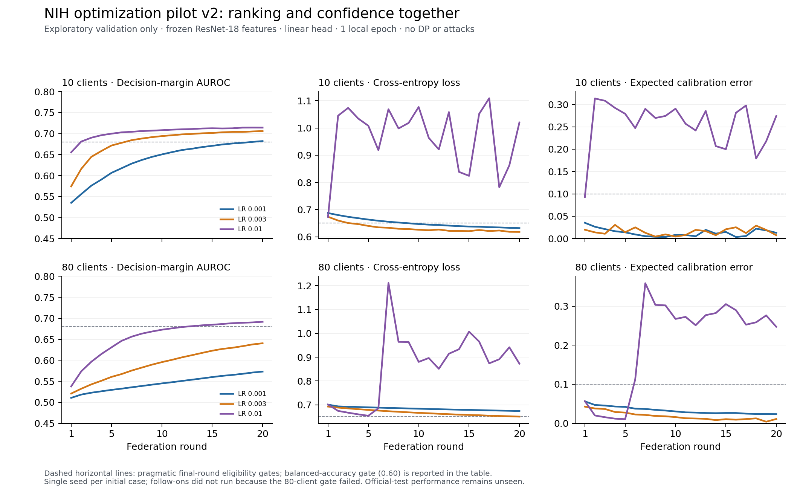

# NIH optimization pilot v2 — results and next decision

19 October 2026. Exploratory validation only. This follows the prospectively
frozen [v2 protocol](nih-optimization-pilot-v2-protocol.md); it does not amend or
replace [v1 evidence](nih-validation-pilot-v1-report.md).

## Verdict

**A stable small-federation candidate exists, but the eighty-client baseline gate
failed.** All six initial cells completed and qualified; none of the eighty-client
cases met all four fixed eligibility criteria. The runner retained those results,
selected no LR and explicitly marked all four conditional follow-ons unrun. Its
exit code 2 and `complete=false` express this planned stop, not a training crash.
No seed-repeat, clipping, trimmed-mean, DP or attack result comes from v2.

Ten clients at LR 0.003 gave margin AUROC **0.705962**, cross-entropy **0.618022**,
balanced accuracy **0.628419** and ten-bin ECE **0.007593**. It passes the pragmatic
baseline criteria in this one seed, not a clinical acceptance standard. Its
finding-label sensitivity is only **0.425301** at the fixed argmax threshold.
Small ECE alone does not establish useful diagnosis, subgroup calibration or
transport to the official test distribution.

## Prospective identity and verification

The budget was committed at `47c53c0`, before v2 training. Its document SHA-256 is
`802f9581ae18b338090384e5cbcb6dfcfe1a978d8a0e34f38dee889e123046ac`.
The corrected runner/tests were committed at `dbfb1b1`, before the first child.
It uses the fixed qualified cache report
`6c9e6969c6fd762156ef2246323fbdbc5e9cb272c9910a8b1c9b691ab33783fd`.
All 68,650 training and 17,763 validation images remain at natural prevalence;
labels, whole-patient split and ownership, representation and threshold are fixed.
Official-test classifier performance remains unseen. Prior source/test metadata,
prevalence and image-content audits were already inspected and disclosed.

Each case used base seed 20261019, twenty rounds, one local epoch, batch 256,
a 1,026-parameter linear head, raw frozen ResNet-18 features, SGD without momentum
or weight decay, uniform mean without clipping, all clients each round and no
DP/attacks. The primary score is explicitly `margin_v2`; probability AUROC remains
a separately named diagnostic. Source/config/cache identities and actual CPU/four
thread execution were checked. Parent helper origins and isolated-child module
origins/bytes bind execution to the intended checkout rather than inherited
Python paths. The private manifest binds 140 source/protocol files; every child
retains an executed-source proof.

Before real data ran, focused tests covered fixed recipes, eligibility and ties,
nonprotocol-cache rejection, a competing Python-path subprocess, foreign parent
helpers, child failure/timeout, source mutation and budget exhaustion. The full
framework suite passed **1,817 tests**, 14 deselected, **81.26% coverage**, in
193.15 seconds with unhandled thread exceptions treated as errors. A separate
checker then reloaded all six real records and 120 rounds, validated hashes,
code/config identity, finite metrics and confusion fractions, independently
rebuilt patient assignments/counts from the curated CSVs, checked executed-source
proofs and independently confirmed no eligible eighty-client case. It imports
no production pilot, partition, config or metric helpers.

## All initial cases

Eligibility requires final AUROC >= 0.68, balanced accuracy >= 0.60, loss <= 0.65
and ECE <= 0.10 simultaneously. These were fixed after v1 but before v2, for
exploratory research readiness. They are not significance or clinical thresholds.
Only final rounds enter selection. All six curves and poor cases are retained.

| Clients | LR | Margin AUROC | Loss | Balanced accuracy | ECE | Eligible | Child seconds |
| ---: | ---: | ---: | ---: | ---: | ---: | --- | ---: |
| 10 | 0.001 | 0.682132 | 0.632029 | 0.613870 | 0.012984 | yes | 7.845 |
| 10 | 0.003 | 0.705962 | 0.618022 | 0.628419 | 0.007593 | yes | 7.448 |
| 10 | 0.01 | 0.714164 | 1.020265 | 0.540989 | 0.274075 | no | 7.461 |
| 80 | 0.001 | 0.573179 | 0.674145 | 0.544531 | 0.023471 | no | 8.469 |
| 80 | 0.003 | 0.640542 | 0.650582 | 0.584427 | 0.011083 | no | 8.324 |
| 80 | 0.01 | 0.691687 | 0.872764 | 0.531480 | 0.247075 | no | 8.150 |

At ten clients, the highest-AUROC candidate (LR 0.01) has loss 1.020265 and ECE
0.274075, and fails the gate. At eighty clients, LR 0.01 also has the highest
AUROC, but loss 0.872764, balanced accuracy 0.531480 and ECE 0.247075. Ranking
alone would again select a poor confidence/threshold operating point. At the
lower eighty-client rates, confidence is less problematic but learning is weak.
This is not explained by probability saturation: margin/probability AUROC differs
by less than 0.000001 in every final v2 case.

The four unrun IDs are `clients80_repeat_20261020`, `clients80_repeat_20261021`,
`clients80_clip_mean` and `clients80_clip_trimmed`. No selected LR exists and no
three-seed interval/mean is reported. Do not select the ten-client winner as if it
were the protocol's eighty-client winner, or add favorable follow-ons to v2.

## Confusion counts and prevalence

Validation contains 7,470 finding-label and 10,293 No Finding images. Majority
accuracy is **0.579463**, balanced accuracy 0.5. These counts reconcile recorded
sensitivity/specificity and accuracy with known class totals; they are not an
independent prediction-level recomputation.

| Clients | LR | True positive | False negative | True negative | False positive |
| ---: | ---: | ---: | ---: | ---: | ---: |
| 10 | 0.001 | 2919 | 4551 | 8615 | 1678 |
| 10 | 0.003 | 3177 | 4293 | 8559 | 1734 |
| 10 | 0.01 | 833 | 6637 | 9989 | 304 |
| 80 | 0.001 | 1751 | 5719 | 8797 | 1496 |
| 80 | 0.003 | 2363 | 5107 | 8775 | 1518 |
| 80 | 0.01 | 659 | 6811 | 10033 | 260 |

## Optimization-budget finding

The client count is not an isolated change to DP sensitivity or deployment scale.
At one local epoch and batch 256, the ten-client assignment has **26–30 SGD steps
per client per round** (median 27.5, mean 27.4); the eighty-client assignment has
**3–5** (median 4, mean 3.9). Both expose each training image to twenty nominal
local epochs over the study, but local paths and averaging frequency relative to
those paths differ. Total client minibatch calls actually rise from 5,480 to
6,240; saying the eighty-client study simply did less total computation is wrong.
Uniform averaging over more, smaller client trajectories changes the effective
optimization schedule and weighting. This is an observed confound and a concrete
hypothesis, not proof it alone causes the utility difference.

Practical consequence: compare cohort size only with explicit sample counts,
per-client step budgets, averaging schedule and matched clean baselines. More
clients cannot be interpreted as a pure privacy/noise intervention in this setup.
Before expanding the privacy/robustness matrix, test a separately fixed schedule
probe at the stable LR 0.003. Compare eighty clients with seven local epochs and
twenty rounds against one local epoch and 140 rounds: both use 140 nominal image
passes, but aggregation frequency and eventual privacy composition differ. Keep
v2 immutable and freeze the probe before running it; do not introduce feature
normalization or a new LR sweep without separate evidence.

## Cost, limits and review disposition

The entire pilot took **50.496 seconds**. Individual child execution took
**7.448–8.469 seconds**, including startup, cache loading and execution guards;
engine-only time was **3.525–4.675 seconds**. Peak child RSS ranged from
**706,822,144 to 728,842,240 bytes**. These are sequential cached-head CPU
simulation costs, not 80 physical devices, raw-image training or whole-machine
memory. No regression suite ran concurrently; ordinary background load was not
controlled. The changed startup/guards also preclude a clean speed comparison
with v1. Large-head costs remain unmeasured.

Review identified two Important execution gaps before any real v2 training:
caller-controlled cache identity and inherited module resolution. Both were
reproduced by failing tests, corrected and verified by focused/full checks before
`dbfb1b1`. One Minor remains deferred: the global remaining timeout is computed
before source inspection, so small control/verification overhead can exceed a
strict wall-clock deadline. Child execution remains timeout-bounded; observed
50.496 seconds is far below the 1,800-second budget. Harden this before relying on
a strict scheduling SLA. The old v1 HEAD-only runner is retained historically;
v2's source-origin and byte checks address that limitation for these runs.

This slice does not establish clinical efficacy, convergence, non-IID behavior,
attack resistance, patient-level DP, protected deployment exports, physical-client
performance, full dependency attestation or protection against hostile filesystem
races. It does not reassess all historical/mobile/backend code. Independently
reconciled raw results stay private/ignored and require a fresh off-device
checkpoint; branch publication and advisor approval remain separate actions.
