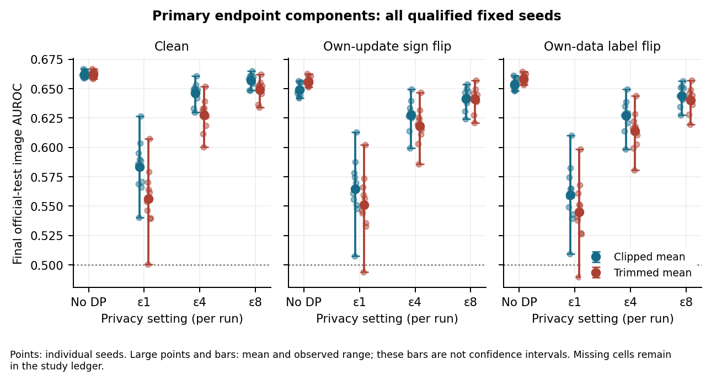
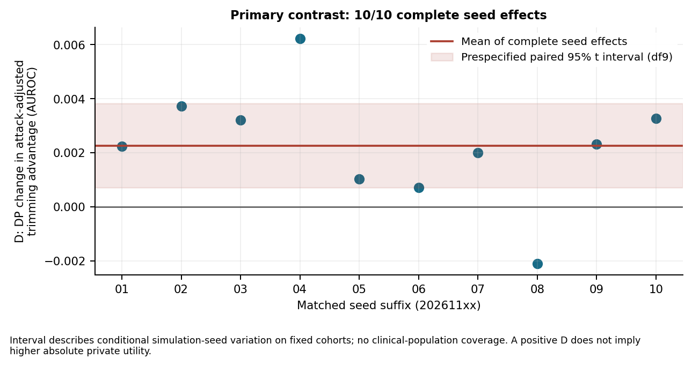

# NIH phase 2: fixed study results

20 October 2026. Independent and source-bound reconciliation passed. Study review
completed; its primary-summary validation gap was reproduced and corrected, with
fast malformed/partial-evidence checks and a fresh 360-model audit. Final assessed
report, presentation and working dashboard remain separate deliverables.

## Verdict

The complete fixed study executed and independently reconciled: **360/360 qualified,
7,200 rounds, zero failures/timeouts/unrun cells**. The primary interaction is small
and positive, but it does not make private trimmed mean the stronger absolute model
in the primary setting. The useful conclusion is conditional configuration guidance,
not a universal aggregation winner or a clinically validated classifier.

## Frozen design and evidence

The [prospective protocol](nih-phase2-study-v1-protocol.md), first committed at
`aa7ae53`, preceded official-test classifier scoring. Source `3baea7d` ran once:
240 primary cells, 72 head cells, 24 cohort cells and 24 clipping cells. No retries,
replacement seeds, test tuning or intermediate-round selection. Test membership,
prevalence and exact-content concerns had been inspected during preparation.

The main recipe is a linear head over frozen pretrained ResNet-18 features, 80
whole-patient simulated clients, 20 rounds, seven local SGD epochs, LR 0.003,
batch 256 and clipping C0.05. Uniform clipped mean and 20% coordinate trimming are
compared with no DP or central epsilon 1/4/8, delta 1e-5, fixed accepted cohorts and
replace-one honest-client/update assumptions. Sign-flip uses each attacker's own
update at scale −4 before clipping; label-flip changes its own binary training labels.
The ten new primary seeds are 20261101–20261110. Secondary families reuse the first
three primary seeds/controls and remain descriptive.

The independent checker verified 148 committed source files, every recipe and
artifact binding, 16 patient allocations, all accepted counts and attackers, direct
checkpoint decoding and both-split reforward for every model, rank-based score
arithmetic, calibration/threshold/weight/mask diagnostics, accounting, payload/FLOPs
and resource scopes. It imports no project runner/model/codec/metric/accountant;
shared underlying Torch kernels remain a limit on numerical independence.
The additional reader from the original source also reproduced the complete saved
analysis exactly.
See the [verification receipt](nih-phase2-study-v1-verification.json) and
[reproduction guide](phase2-reproduction-guide.md). All 3,964 original study files
are hash-verified in a private second-device backup, separate from source/cache.

## Primary contrast and all absolute components

For each seed, B(p) is the sign-flip trimming advantage minus the clean trimming
advantage; D=B(epsilon 4)−B(no DP). Across all ten complete matched effects:

- Mean D: **+0.002266150 AUROC**; sample SD 0.002183178.
- Prespecified paired 95% t interval (df9): **[+0.000704398, +0.003827901]**.
- Seed range: [-0.002104579, +0.006234151].
- Mean B(no DP)=+0.007443034; mean B(epsilon 4)=+0.009709183.

The nominal t interval treats the ten seed-level effects as independent replicates
and relies on an approximately normal effect distribution; those assumptions are
not established by successful execution. Common draws within each matched seed
are intentional. Coverage concerns conditional seed variation on these fixed cohorts,
not clinical populations. It excludes zero under the prespecified method;
that does not establish clinical importance, deployment safety or a universal effect.
The mean change is about 0.227 AUROC percentage points. Eight absolute
components form the contrast; all are included below with the wider descriptive grid.

| Condition | Privacy | Clipped mean AUROC | Trimmed mean AUROC | Trim−mean |
| --- | --- | --- | --- | --- |
| clean | none | 0.662202 | 0.662033 | -0.000169 |
| clean | eps1 | 0.583652 | 0.556279 | -0.027372 |
| clean | eps4 | 0.646336 | 0.627488 | -0.018848 |
| clean | eps8 | 0.656914 | 0.649012 | -0.007902 |
| sign_flip | none | 0.648991 | 0.656265 | +0.007274 |
| sign_flip | eps1 | 0.564652 | 0.550949 | -0.013704 |
| sign_flip | eps4 | 0.627389 | 0.618250 | -0.009139 |
| sign_flip | eps8 | 0.641411 | 0.640940 | -0.000470 |
| label_flip | none | 0.653784 | 0.658595 | +0.004811 |
| label_flip | eps1 | 0.559645 | 0.545062 | -0.014583 |
| label_flip | eps4 | 0.626870 | 0.613827 | -0.013043 |
| label_flip | eps8 | 0.644113 | 0.640349 | -0.003764 |

Each entry is the mean of ten models. Individual seed values, metric/count summaries
and observed ranges are retained in the [64-group table](tables/nih-phase2-v1/all_64_recipe_groups.csv)
and [per-seed contrast table](tables/nih-phase2-v1/primary_per_seed.csv). Only D has
its prespecified formal interval; the other comparisons/ranges are descriptive.

Without DP, trimming improves sign-flip AUROC over mean. At epsilon 4, its attacked
absolute mean is 0.618250 versus 0.627389 for mean, while clean utility is also lower.
A larger attack-adjusted advantage can therefore coexist with lower useful ranking.
At epsilon 1 both rules lose substantial discrimination and show wider seed variation;
epsilon 8 retains more of the no-DP ranking. These are mechanism targets in a public-
data research workflow, not a recommendation for a production privacy budget.

## Head size, cost and matched learning controls

All entries below use the same first three seeds, clean data and clipped mean.
Upload is modeled MB across all 80 clients/20 rounds; download is equal. Observed child
seconds include startup and artifact export, and are not isolated algorithm timings.

| Head | Parameters | No-DP AUROC | Epsilon 4 AUROC | Private−control | Upload MB | Child seconds |
| --- | --- | --- | --- | --- | --- | --- |
| linear | 1026 | 0.663396 | 0.644213 | -0.019183 | 6.8000 | 24.83 |
| mlp8 | 4122 | 0.638214 | 0.624882 | -0.013332 | 26.8528 | 26.19 |
| mlp128 | 65922 | 0.653551 | 0.638896 | -0.014655 | 422.3936 | 31.78 |
| mlp512 | 263682 | 0.655964 | 0.643233 | -0.012731 | 1688.0688 | 40.35 |

MLP512 costs about 248.245 times the linear modeled payload, without a higher private
point mean under this fixed recipe. This is not equivalence or proof that larger
heads cannot learn better after independent validation/tuning. Matched penalties
are not monotone in width, and capacity/optimization change too. Under sign-flip,
MLP8's private trimmed point mean exceeds its private mean counterpart; the primary
linear-head ordering is not a universal rule ranking. All 16 matched head comparisons
are in the [head table](tables/nih-phase2-v1/head_private_minus_no_dp.csv).

See [head penalties](figures/nih-phase2-head-privacy-penalty.png) and
[observed/modeled costs](figures/nih-phase2-head-costs.png).

## Cohort-size sensitivity

Three matched seeds, clean linear head, C0.05; no new formal intervals:

| Clients | Rule | No-DP AUROC | Epsilon 4 AUROC | Private−control |
| --- | --- | --- | --- | --- |
| 10 | mean | 0.676782 | 0.548356 | -0.128426 |
| 10 | trimmed_mean | 0.676841 | 0.529849 | -0.146992 |
| 80 | mean | 0.663396 | 0.644213 | -0.019183 |
| 80 | trimmed_mean | 0.663219 | 0.625086 | -0.038133 |
| 1000 | mean | 0.631585 | 0.630644 | -0.000941 |
| 1000 | trimmed_mean | 0.630617 | 0.628835 | -0.001782 |

A thousand simulated clients reduce the private/no-DP gap in this recipe, yet their
absolute private mean is below the eighty-client point mean. Ten clients have a
higher no-DP baseline but lose substantially more under DP. Cohort size changes
aggregate sensitivity and local data/minibatch trajectories; it is not a pure noise
experiment or evidence from a thousand physical devices. See the
[cohort figure](figures/nih-phase2-cohort-sensitivity.png).

## Clipping sensitivity

Each difference is matched C0.4 minus C0.05, first three seeds. The final columns give
absolute C0.4 means, preventing a difference-only interpretation:

| Condition | Rule | No-DP difference | Epsilon4 difference | C0.4 no-DP AUROC | C0.4 epsilon 4 AUROC |
| --- | --- | --- | --- | --- | --- |
| clean | mean | +0.000142 | -0.085239 | 0.663538 | 0.558975 |
| clean | trimmed_mean | +0.000111 | -0.077123 | 0.663330 | 0.547964 |
| sign_flip | mean | -0.154578 | -0.104571 | 0.495854 | 0.520096 |
| sign_flip | trimmed_mean | +0.000492 | -0.069883 | 0.658057 | 0.546027 |

At C0.4, no-DP sign-flip mean falls to about 0.496 while trimming retains about 0.658.
At epsilon 4 in this higher-clipping case, trimming's point mean is about 0.546 versus
0.520 for mean. Thus an aggregation decision depends on clipping and attack setting.
Increasing C changes signal truncation, permissible attack magnitude and calibrated
noise together; the experiment does not identify their separate causal contributions.
See the [clipping figure](figures/nih-phase2-clipping-sensitivity.png).

## Threshold, patient weighting and content sensitivity

For primary clean epsilon 4 clipped mean, the validation-selected 80% recall threshold
transfers to mean test recall0.915729
and specificity0.241375; default
margin prediction gives recall0.619790.
A validation target does not specify the resulting test operating point. This example
improves recall while leaving low specificity, not a demonstrated clinical threshold.

Inverse images-per-patient weighting changes that group's AUROC by
+0.077657 on average. Image-level and
patient-weighted results answer different weighting questions; the latter is not a
patient classifier. The nine-image frozen mask changes any individual model AUROC
by at most 0.000165502 in absolute value. A small measured sensitivity does not
certify remaining labels or near-duplicate independence. All seven evaluation modes
and confusion counts, including fractional patient weights, remain in the
[evaluation table](tables/nih-phase2-v1/all_360_evaluation_modes.csv).

## Resources, interpretation and delivery boundary

Recorded child execution totaled 10446.316 seconds against
the 10,800-second cap; parent control was 2834.088 seconds,
for 13280.404 recorded total seconds. Maximum engine-completion
process high-water RSS was 1573.469 MiB, below 2 GiB. This is not an enforced
process-tree or post-engine artifact memory bound. FLOPs cover the declared matmul
estimator, and payloads are arithmetic rather than observed network traffic.

Cell order was fixed. Early capture used battery until external charging resumed;
a limited closed-cell backup overlapped capture. Ordinary background load, power
transition and fixed order limit timing comparisons. No concurrent regression or
source edit ran during capture. Source-bound reanalysis afterward does not alter
these measurements or replace outcomes.

The server sees raw updates; seeds and pre-noise diagnostics are research exports.
Marginal run accounting does not establish patient-level DP, whole-matrix composition,
privacy-safe logs or clinical validity. Matched common draws need a separate joint
release analysis; the [specific cancellation example](matched-noise-release-boundary.md)
is not a general objection to designed correlated-noise mechanisms.

The practical actions are to qualify data/content, show actual cohort and rule-
specific sensitivity/noise, compare absolute utility against matched controls, keep
threshold/confusion and patient-weight diagnostics, and validate larger heads before
paying their modeled payload. The [practical guidance](fedlearn-practical-guidance.md)
connects these observations to platform work. The dashboard, final report layout,
presentation, title/format confirmation and delivery rehearsal remain open; execution
and this study report alone do not complete the capstone.
