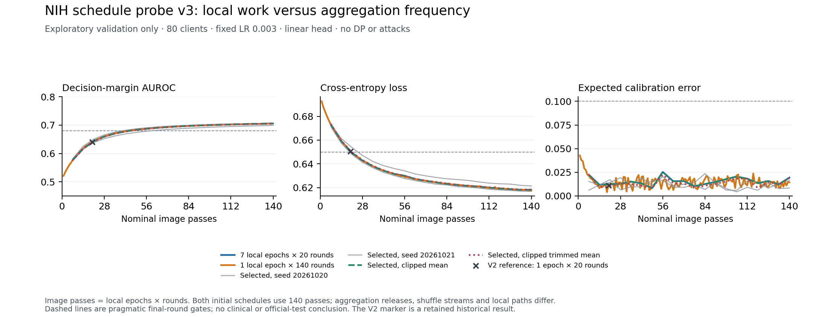

# NIH schedule pilot v3 — a stable eighty-client baseline

19 October 2026. Exploratory validation only. The [v3 protocol](nih-schedule-pilot-v3-protocol.md)
was fixed after the [failed v2 eighty-client gate](nih-optimization-pilot-v2-report.md),
before any v3 training. This does not amend earlier records or pre-register the
confirmatory study. Official-test classifier performance remains unseen.

## Verdict

**The core optimization gate now passes across all three declared seeds.**
Eighty clients at LR 0.003, seven local epochs and twenty rounds give three-seed
margin-AUROC mean **0.703844**, range **0.699003–0.706996**. Loss is
**0.616709–0.621308**, balanced accuracy **0.632061–0.643708**, and ten-bin ECE
**0.008377–0.019428**. These are descriptive simulation-seed values, not confidence
intervals, clinical acceptance or evidence of convergence.

Both initial schedules met every gate. The frozen preference selected seven local
epochs/twenty rounds rather than one epoch/140 rounds; this was a preference for
fewer aggregation releases, not a post-hoc choice of the lowest loss. The clean
clipped-mean and clipped-trimmed cases also passed in their declared base seed.
No DP/attack result or large-head conclusion comes from this pilot.

## Fixed methods and source identity

Protocol commit `1d9075a`; SHA-256
`b5dc45e3318dd45ca511e25252c70963e5c3e66beac37ca88987c6da2fbec8eb`.
Runner/tests were committed at `7ea93f5` before the first real v3 child. The cache
report remains
`6c9e6969c6fd762156ef2246323fbdbc5e9cb272c9910a8b1c9b691ab33783fd`:
all 68,650 training and 17,763 validation images, natural prevalence, eighty patient-IID
clients, a 1,026-parameter linear head and frozen pretrained ResNet-18 features.
CPU/four threads, SGD without momentum/weight decay, LR 0.003, batch size 256, all clients,
no server optimizer, DP, attacks, balancing or feature transformation. Argmax
thresholding and versioned `margin_v2` scoring remain fixed.

The initial schedules both expose each image to140 nominal local epochs and have
the same total client minibatch calls. They differ in aggregation frequency,
local trajectories and round-derived shuffle streams; they are not numerically
equivalent or a pure one-factor causal experiment. Seven local epochs give
21–35 steps/client/round, close to v2's ten-client 26–30 step range. Relative to v2's
80-client run they also use seven times the nominal image exposure. The probe
supports a schedule explanation, not a claim that larger cohorts inherently
reduce utility or that exposure alone identifies every causal contribution.

## All six cells

Only final-round metrics enter eligibility. The fixed gates are AUROC >= 0.68,
balanced accuracy >= 0.60, loss <= 0.65, ECE <= 0.10. They are research-readiness rules
chosen after earlier exploratory results, not clinical or significance thresholds.
No cell failed, timed out or was omitted; all 240 rounds are retained.

| Cell | Epochs / rounds | Margin AUROC | Loss | Balanced accuracy | ECE | Eligible | Child seconds |
| --- | --- | ---: | ---: | ---: | ---: | --- | ---: |
| `local7_round20` | 7 / 20 | 0.705532 | 0.618090 | 0.643708 | 0.019428 | yes | 14.024 |
| `local1_round140` | 1 / 140 | 0.705743 | 0.617567 | 0.638662 | 0.014430 | yes | 30.379 |
| `selected_repeat_20261020` | 7 / 20 | 0.706996 | 0.616709 | 0.642640 | 0.016297 | yes | 13.651 |
| `selected_repeat_20261021` | 7 / 20 | 0.699003 | 0.621308 | 0.632061 | 0.008377 | yes | 13.513 |
| `selected_clip_mean` | 7 / 20 | 0.705532 | 0.618090 | 0.643708 | 0.019428 | yes | 13.465 |
| `selected_clip_trimmed` | 7 / 20 | 0.705190 | 0.618361 | 0.642790 | 0.018955 | yes | 13.373 |

Curves use image passes (epochs×rounds), while the table retains aggregation-round
counts. The v2 marker is historical, not a rerun. Neither an intermediate round
nor an additional LR was selected. The two seed repeats change partition,
initialization and shuffling together; three seeds do not isolate those sources.

Validation has 7,470 finding-label and 10,293 No Finding images; majority accuracy
is 0.579463. Confusion counts below are reconciled from recorded fractions and
known totals, not recomputed from separately retained prediction vectors.

| Cell | True positive | False negative | True negative | False positive |
| --- | ---: | ---: | ---: | ---: |
| `local7_round20` | 3732 | 3738 | 8109 | 2184 |
| `local1_round140` | 3518 | 3952 | 8300 | 1993 |
| `selected_repeat_20261020` | 3695 | 3775 | 8138 | 2155 |
| `selected_repeat_20261021` | 3513 | 3957 | 8171 | 2122 |
| `selected_clip_mean` | 3732 | 3738 | 8109 | 2184 |
| `selected_clip_trimmed` | 3727 | 3743 | 8097 | 2196 |

The selected base seed has finding-label sensitivity 0.499598 and specificity
0.787817. Passing the research gate does not establish clinical-quality detection,
subgroup calibration or transfer to the different official-test distribution.

## Clipping and clean robust aggregation

At C=0.4 no update was clipped in any v3 round: recorded clip rates are 0 and
mean shrink factors 1. The clipped-mean run matches the selected unclipped run's
final model digest and every round's eight utility metrics exactly. This is a
record/digest comparison, not a separately saved full-parameter bitwise comparison.
C=0.4 therefore has no observed clean clipping penalty in this pilot, and may be
a loose noise-calibration bound; no claim of an optimal C follows.

Clean trimmed mean (trim 0.2) gives AUROC 0.705190 versus clipped mean 0.705532,
loss 0.618361 versus 0.618090, and balanced accuracy 0.642790 versus 0.643708 in the
same base seed. This small observed clean cost is not a significance result or
proof of protection against attacks. Retain matched clipped-mean controls in the
prospective study rather than compare rules under unmatched preprocessing.

## Communication and execution cost

At equal 140 image passes, the 20-round schedule estimates **6,800,000 bytes up and
6,800,000 bytes down**, versus **47,600,000 bytes each direction** for 140 rounds:
exactly seven times less modeled application payload. These are simulator transfer
estimates, not measured network traffic, packet overhead, bandwidth or phone energy.
Fewer rounds are also fewer release/accounting events; actual DP calibration and
utility have not been tested here.

The 20-round initial case took **14.024s** of isolated child execution, versus
**30.379s** for 140 rounds. Federation-loop times were 10.334829s and 26.761529s. Recorded
training-stage time was 7.486146s versus 7.471801s; evaluation-stage time was
1.690242s versus 12.079577s. Thus the end-to-end difference includes much more
frequent evaluation and orchestration, rather than a demonstrated reduction in
training arithmetic. Stage timers cover selected operations and need not sum
to the whole federation-loop wall time.

All six children together took **98.405573s**; separately measured parent control
and verification took **3.594475s**, total **102.000048s**. Isolated child time
includes Python startup, cache loading and child source guards. The legacy
engine-time field covers only `SimulatedFederation.run`, excluding engine setup,
cache validation/loading, partitioning and initialization. A full engine-call
duration was not recorded in v3; these numerical records remain unchanged.
Child RSS ranged **727,023,616–730,988,544 bytes**, measured per process,
not for the whole machine. Runs were sequential with no concurrent regressions;
ordinary desktop background load was uncontrolled. This is cached-head CPU
simulation, not physical-device or raw-image CNN performance.

## Verification and limits

Before real training, 33 focused and 1,832 full framework tests passed
(14 deselected, 81.26% coverage, 184.38s). The full run treated unhandled thread
exceptions as errors. Review found that interrupted children lost their source
proof and that timing scopes included parent overhead. Failing regressions
reproduced both; the correction atomically saves a before-engine proof and a
separate after-engine-return proof, validates both before qualification and
accounts child/control time separately. An actual interrupted synthetic child
kept its initial proof without a completion claim. Missing/tampered proofs,
failures/timeouts, source changes and no-survivor selection are tested.

The independent real-run checker imports no production pilot/config/partition/
metric helper. It verified all six records/240 rounds, 142 source/protocol
fingerprints, both proof phases for every child, hashes/configs, whole-patient
assignments/counts, confusion fractions, final eligibility, declared schedule
preference, all three core seeds and timing totals. A separate audit reconciled
payload totals and clipping/digest/metric identity. Final PNG/SVG curves were
rendered and visually inspected. Raw records and row identities stay private/
ignored and require a new off-device checkpoint.

Practical conclusions supported now:

1. Gate on ranking **and** loss/operating-point/calibration diagnostics. v1/v2's
   ranking-only winners were overconfident; v3 provides a stable research baseline.
2. Record image exposure, local minibatch counts and averaging frequency with
   cohort comparisons. Keeping epochs/rounds fixed did not hold optimization
   trajectories fixed when client shards shrank.
3. More local work can trade for fewer aggregation events in this patient-IID
   cached-head setting. Here matched exposure gave similar validation utility,
   one-seventh the modeled payload and lower evaluation/orchestration cost.
   Non-IID drift, physical battery cost and protected-release utility remain untested.
4. Measure clean clipping and robust-rule effects before attributing differences
   to noise or attacks. No observed clipping at C 0.4 is not proof it is the best
   privacy/utility setting.

Next: complete the attack-knowledge/accounting boundary audit and bound larger-
head cost, then freeze a separate exact confirmatory protocol. The IPM/ALIE
implementations use raw honest-update statistics; the single-upload sensitivity
assumption must not be silently carried through a data-dependent attack oracle.
No official-test evaluation, formal end-to-end privacy/export guarantee,
attack-resistance or large-head conclusion is established by v3.
