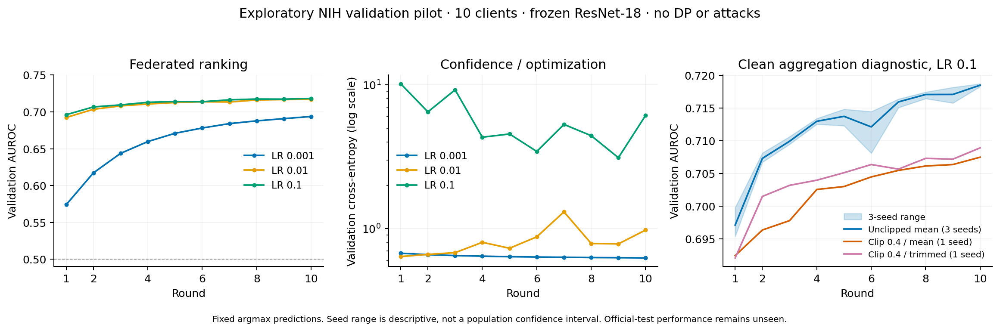

# NIH validation pilot v1 and score diagnostic

19 October 2026. Exploratory, validation only. **No official-test classifier
performance has been inspected.**

## Verdict and next gate

The source-bound workload and whole-patient simulator work, and the frozen features
contain useful ranking information. **The AUROC-selected optimizer is not ready
for the confirmatory study:** its loss and confidence calibration are poor. A
separate replay also confirmed that float32 probability saturation materially
corrupts the existing AUROC calculation in one high-rate pooled case. Fix/version
the scoring path and establish a stable optimization baseline before interpreting
privacy or attack effects.

The v1 runner's `ready_to_draft_confirmatory_protocol` flag means only that its
predeclared AUROC heuristic passed. It does not certify calibration, numerical
score fidelity or study readiness. The flag and all original records are retained,
not retrospectively edited to match this broader review.

## Prospectively fixed pilot and evidence

The [v1 budget](nih-validation-pilot-protocol.md) was committed at `6083237` before
any real classifier run. Code `27e10bb` executed exactly eleven cells: six pooled/
ten-client LR cases, two selected-LR seed repeats, two clean clipping/rule
diagnostics and one 1,000-client/two-round execution check. All eleven completed;
all **102 rounds** qualified. Total parent elapsed time was **68.63 seconds**.
No failed, timed-out or omitted cells, extra LR choices or intermediate-round
selection occurred.

The pinned cache is
`6c9e6969c6fd762156ef2246323fbdbc5e9cb272c9910a8b1c9b691ab33783fd`.
Every case used all 68,650 training and 17,763 validation images, patient grouping,
natural prevalence, 512 frozen ImageNet ResNet-18 features, a 1,026-parameter linear
head and CPU/four threads. There was no DP, attack, balancing or feature fitting.
The natural validation majority baseline is **57.9463% accuracy**, with balanced
accuracy 0.5. These are report-derived No Finding/any-finding labels, not diagnoses.

An independent script imported no pilot/workload helpers. It re-read the source
CSV class counts, rebuilt patient assignments and digests with the declared PCG64
allocation, verified every config/code/cache/model/manifest identity and record
hash, checked round completeness, reconciled metric fractions and independently
selected the declared LR. Confusion counts in the main pilot summary were
reconstructed from recorded sensitivity/specificity and known class counts, not
independently re-predicted. The three later logit replays did independently check
their prediction-level confusion counts.

## All final-round v1 results

AUROC here means the **original float32 probability-score AUROC**. It is retained
as measured, including the saturation failure diagnosed below. ECE is the
existing ten-bin top-label confidence error. All values are validation results.

| Case | LR | AUROC | Accuracy | Balanced accuracy | Loss | ECE | Parent seconds |
| --- | ---: | ---: | ---: | ---: | ---: | ---: | ---: |
| Pooled | 0.001 | 0.719872 | 0.676800 | 0.667443 | 0.612794 | 0.025980 | 5.864 |
| Pooled | 0.01 | 0.718621 | 0.426786 | 0.505006 | 1.722762 | 0.497844 | 5.876 |
| Pooled | 0.1 | 0.564571 | 0.421888 | 0.501074 | 16.213999 | 0.577235 | 5.798 |
| Ten clients | 0.001 | 0.693723 | 0.654619 | 0.622071 | 0.625391 | 0.011106 | 5.867 |
| Ten clients | 0.01 | 0.716880 | 0.615662 | 0.549593 | 0.976961 | 0.259102 | 5.910 |
| Ten clients, selected | 0.1 | 0.718259 | 0.632607 | 0.573577 | 6.127444 | 0.349491 | 5.887 |
| Selected, seed 20261020 | 0.1 | 0.718697 | 0.621911 | 0.558105 | 6.629354 | 0.362385 | 5.915 |
| Selected, seed 20261021 | 0.1 | 0.718461 | 0.666498 | 0.631531 | 3.948455 | 0.307283 | 5.915 |
| Selected, clip 0.4 / mean | 0.1 | 0.707462 | 0.601250 | 0.529795 | 6.323635 | 0.385569 | 5.956 |
| Selected, clip 0.4 / trimmed mean | 0.1 | 0.708891 | 0.643472 | 0.593599 | 3.630614 | 0.326622 | 5.977 |
| 1,000 clients, two rounds | 0.1 | 0.679277 | 0.586387 | 0.509389 | 1.275101 | 0.340935 | 7.063 |

The fixed rule selected LR **0.1**, using only final ten-client AUROC. Across the
three declared seeds its AUROC mean was **0.718472**, range **0.718259–0.718697**.
This descriptive stability in ranking coexists with losses **3.948–6.629** and
ECE **0.307–0.362**. It is not a population confidence interval or evidence of
reliable probabilities. The slightly higher AUROC at LR 0.1 than 0.01 did not
justify its much worse confidence behavior.

The single-seed clipped mean/trimmed comparison cannot establish attack resistance
or a general robust-aggregation recommendation. In this clean, uncalibrated
setting, both have lower measured probability-score AUROC than the selected
unclipped mean. Correct the score/optimization issues before interpreting that
difference as an aggregation effect.

Selected prediction counts (positive = any finding):

| Case | TP | FN | TN | FP |
| --- | ---: | ---: | ---: | ---: |
| Pooled LR 0.001 | 4,546 | 2,924 | 7,476 | 2,817 |
| Ten clients LR 0.1 | 1,510 | 5,960 | 9,727 | 566 |
| Clip 0.4 / mean | 599 | 6,871 | 10,081 | 212 |
| Clip 0.4 / trimmed mean | 2,090 | 5,380 | 9,340 | 953 |
| 1,000 clients, two rounds | 186 | 7,284 | 10,230 | 63 |

All eleven confusion matrices remain in the private reconciled summary. The
counts show why ranking alone is insufficient: a seemingly useful ordering can
coexist with poor fixed-threshold behavior.

## Verified numerical scoring defect

The evaluator at `framework/src/fedlearn/simulation/metrics.py:40` computes binary
AUROC from float32 `softmax(logits)[:,1]`. A four-example synthetic control with
margins 20,21,22,23 and labels 0,0,1,1 produces probabilities all exactly 1. Its
probability AUROC is 0.5 despite a margin AUROC of 1.0. The rank statistic is
tie-aware; finite-precision probability conversion has destroyed the ordering.

The [separate diagnostic budget](nih-score-diagnostic-protocol.md), committed at
`00b9acc` before real logit capture, fixed three exact replays and no new training
conditions. All four source modules matched v1 bytes; every replay matched its
original final model digest and all seven utility metrics in all ten rounds.
The extension completed in **17.87 seconds**. Final logits/labels were retained
privately, and a separate NumPy tie-rank calculation checked both score forms.

| Exact v1 replay | Probability AUROC | Margin AUROC | Probabilities exactly 1 | Distinct probabilities / margins |
| --- | ---: | ---: | ---: | ---: |
| Pooled LR 0.001 | 0.719872352 | 0.719872345 | 0 | 17,749 / 17,759 |
| Pooled LR 0.1 | 0.564570637 | 0.718015311 | 15,729 | 785 / 17,756 |
| Ten clients LR 0.1 | 0.718258779 | 0.718258695 | 160 | 17,353 / 17,755 |

For the high-rate pooled case, saturation changes reported AUROC by **0.153445**.
The selected federated case's difference is negligible, so this defect does not
explain away its poor loss/calibration. Better scoring does not repair its
predictions or confidence.

Binary decision values are an accepted AUROC input in the
[scikit-learn documentation](https://scikit-learn.org/stable/modules/generated/sklearn.metrics.roc_auc_score.html).
The next scoring version should use the double-precision difference
`logit_1 - logit_0`, retain probability AUROC as a labelled diagnostic if useful,
and preserve historical behavior behind an explicit compatibility path. Do not
silently rewrite v1 or earlier Milestone 2 records. The historical magnitude of
this issue is unknown without their logits or controlled replays.

## Execution costs and practical consequences

The 1,000-client check used 22–23 patients per client, 27–198 images per client,
all 68,650 training images and two rounds. It took **7.063 seconds** including
child startup/cache loading and **3.560 seconds** inside the simulation run.
Its OS peak RSS was **735,051,776 bytes**, a process measurement rather than
whole-machine/tree memory. Ten-client selected training took **5.887 seconds**
end-to-end and **2.435 seconds** inside its ten-round simulation. Children ran
sequentially, with no concurrent regression suite; ordinary desktop background
load was not controlled.

These costs concern a sequential CPU simulator training a tiny head over cached
features, not 1,000 physical devices, raw-image CNN training or measured network
latency. Two rounds establish execution, not convergence. They do not predict
costs of the 263k-parameter head. Separately, the earlier 641-second feature
preparation overlapped regression checks and is an observed preparation cost,
not an isolated throughput benchmark.

Practical outputs for FedLearn so far:

1. **Gate experiments on stable metrics and multiple utility measures.** Highest
   probability AUROC alone selected an overconfident model; low-rate pooled
   learning shows the representation itself need not be discarded.
2. **Use a numerically stable binary ranking score.** Retain the score definition
   and version with every result; saturation can masquerade as lost ranking.
3. **Keep patient ownership and sample counts separate.** Equal patient counts
   produce substantially unequal image counts. Changing client count also changes
   per-client data and minibatch/update counts; do not attribute every utility
   difference to reduced DP noise.
4. **Measure head-size cost before expanding the matrix.** Small-head simulation
   is inexpensive here; no large-head or deployment-speed claim follows.
5. **Keep research logs separate from protected deployment releases.** The
   [output audit](privacy-output-boundary-audit.md) remains a release-design gate.

Next: explicitly version stable NIH scoring with unchanged legacy anchors, then
freeze a bounded optimization/conditioning diagnostic with loss/calibration
criteria before launching it. Any normalization must preserve row ownership and
avoid silently fitting shared statistics on private client data. Confirmatory
privacy/robustness runs and official-test inspection remain on hold.
