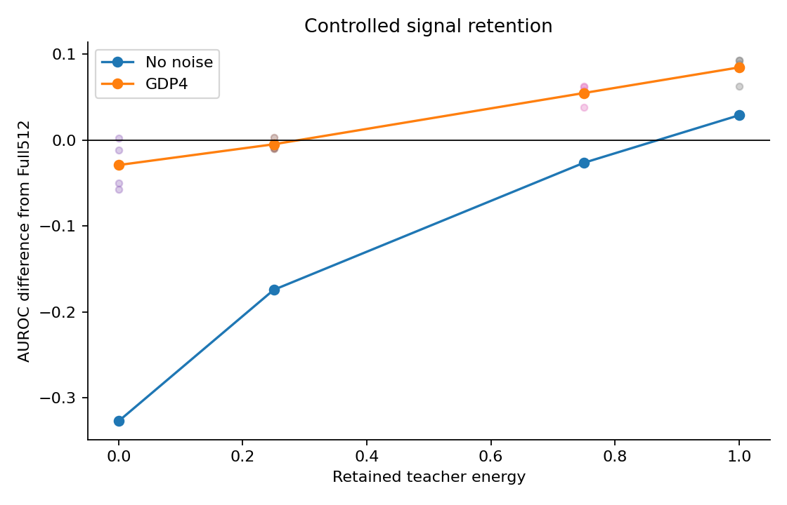
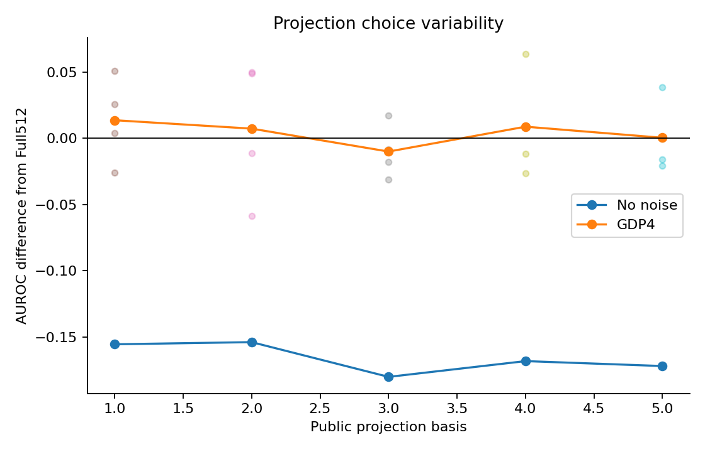
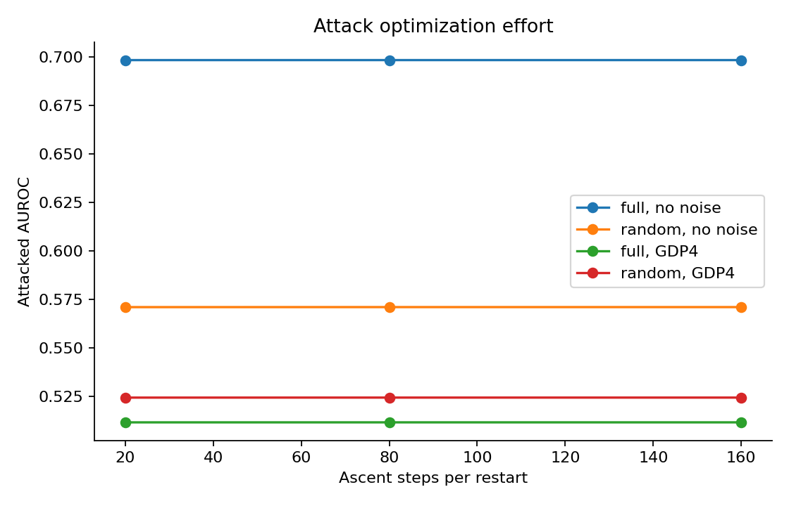

# Projection helps only when useful signal survives

Generated-data mechanism study · 28 October 2026

**Verdict:** The controlled results support a conditional explanation, not a general projection defense. Retaining enough predictive signal can improve private utility; discarding it erases the benefit. Random subspaces produce both positive and negative private gains. Increasing attack optimization effort changes these tested means very little, but does not certify worst-case robustness. This extension strengthens the capstone's explanatory evidence without establishing methodological novelty or independent medical validity.

## Question, design and completed evidence

The existing NIH comparison changes representation, clipping, optimization and noise together, and its twelve training seeds share one projection basis. This extension asks which explanations survive controlled changes to signal retention, basis choice and attacker effort. It does not reopen medical inputs, the holdout, test models or saved predictions.

All data are generated once:512 independent standard-normal features, teacher β=e₀, and labels drawn from Bernoulli(sigmoid(2x₀));4096 training and8192 evaluation examples. Twenty logical clients train a zero-initialized two-output linear head for20 full-participation rounds, one SGD epoch per round, batch128, LR0.03 and outer clip0.05. Private arms use ε=4, δ=1e-5 GDP calibration with per-release sensitivity0.005 and coordinate-noise SD approximately0.024176. There is no subsampling amplification, backbone training or physical-host variable.

The approved matrix completed **136/136 main cells**, **2720 rounds** and **54400 client fits**, with no replacement fits. Twelve separate qualification cells completed240 rounds and4800 fits before main measurement. Across both stages,148 cells,2960 rounds and59200 client fits completed once. Main results are [public JSON](projection-study-results-2026-10-28.json); the [prospective manifest](projection-study-manifest-2026-10-28.json) and [qualification receipt](projection-qualification-2026-10-28.json) were committed at `0ecd8af` before main fitting. All scientific implementation corrections preceded qualification at source checkpoint `1e44031`.

The table values below are final AUROC means across four training seeds on one fixed generated evaluation set. They are descriptive points, not population confidence bounds. Common random numbers deliberately pair comparisons. The synthetic recipe differs from NIH; in particular twenty rather than eighty clients gives four times its clipped-mean sensitivity at the same C. Absolute utilities are not a matched medical comparison.

## 1. Signal retention determines whether projection helps

Controlled128 uses four orthonormal subspaces retaining exactly η of the known teacher's squared norm. The dataset and teacher stay fixed as η changes. These teacher-informed subspaces are diagnostic oracle controls, not a proposed deployable basis-selection algorithm.

| Representation | Retained energy η | No-noise AUROC | GDP4 AUROC | No-noise gain vs Full512 | GDP4 gain vs Full512 |
| --- | ---: | ---: | ---: | ---: | ---: |
| Full512 | 1, in512 dimensions | 0.817257 | 0.532373 | 0 | 0 |
| Controlled128 | 0 | 0.490014 | 0.503203 | −0.327243 | −0.029170 |
| Controlled128 | 0.25 | 0.642828 | 0.527375 | −0.174429 | −0.004998 |
| Controlled128 | 0.75 | 0.790752 | 0.587044 | −0.026506 | +0.054671 |
| Controlled128 | 1 | 0.846058 | 0.616847 | +0.028800 | +0.084473 |

Private gain changes sign between the measured η=0.25 and0.75 points. This brackets a change on the chosen grid; it does not locate a precise threshold. All four paired training effects favor η=0.75 and1 under privacy. At η=0.25, three of four effects are negative. At η=0 the retained features are independent of the population label mechanism; finite-sample AUROC near0.5 is expected.

The fully aligned128-dimensional control already improves no-noise AUROC by0.028800. Its entire private gain therefore cannot be attributed solely to DP-noise reduction. The experiment controls retained signal but still changes local gradient/clipping trajectories and finite-sample learning. It is not a complete additive decomposition of all causal effects. The known teacher score2x₀ attains0.859775 AUROC against the fixed generated evaluation labels; that is a reference score, not a population-performance bound or another fitted model.

## 2. One projection basis does not characterize projection uncertainty

Five predetermined public random bases were crossed with all four training seeds. None was selected by its outcome. Retained teacher energy and summaries are independently derived in the [supplement](projection-study-derived-2026-10-28.json).

| Public basis seed | Retained teacher energy | No-noise AUROC | GDP4 AUROC | GDP4 gain vs Full512 | Within-basis GDP4 training-seed SD |
| --- | ---: | ---: | ---: | ---: | ---: |
| 20261101 | 0.276566 | 0.661757 | 0.545908 | +0.013535 | 0.009716 |
| 20261102 | 0.272852 | 0.663377 | 0.539567 | +0.007194 | 0.027989 |
| 20261103 | 0.225163 | 0.637171 | 0.522270 | −0.010104 | 0.013800 |
| 20261104 | 0.236856 | 0.649061 | 0.541034 | +0.008660 | 0.016531 |
| 20261105 | 0.239445 | 0.645342 | 0.532668 | +0.000295 | 0.009316 |

The sample SD across the five GDP4 basis means is0.009158. Within-basis training-seed SDs range0.009316–0.027989. These are separate finite-grid summaries, not estimated independent variance components. The twenty points are not twenty independent basis draws, and reused Full512 comparisons do not create additional baseline samples.

The sign change shows that a benefit is not stable across every tested subspace in this generated workload. It does not show that the original NIH projection was lucky, or estimate its basis-selection variability. That clinical question remains untested.

## 3. Total parameter-noise energy is not a sufficient utility explanation

Padded512 appends384 exact zeros to the same Random128 features. It increases stored/noised parameters from258 to1026 while preserving the prediction function. Active weight rows and biases receive explicitly coupled Gaussian draws; inactive entries receive independent draws. Each marginal release remains isotropic in its own stored parameter space.

For coordinate-noise SD σ, expected squared parameter-noise norm is `(2k+2)σ²`, whereas conditional logit-difference variance at fixed x is `2σ²(||x||²+1)`. These are elementary Gaussian identities, not new theory. Padding changes the first quantity and leaves the second unchanged.

The expected energy ratio is1026/258=3.976744. Across the eighty private releases per representation, the observed pooled ratio is **4.009877**, while the maximum paired prediction-score discrepancy is **4.361227e-7**, below the prespecified1e-5 tolerance. Per-round clipping decisions also match. Thus additional noise in feature-null coordinates changes parameter energy without materially changing predictions on this training path.

This refutes the explanation that fewer stored noisy parameters alone must improve utility. It does not imply that noise in arbitrary full-feature directions is harmless, or authorize reduced-rank noise for an unrestricted full-dimensional private update.

## 4. More optimization barely changes this attack, not every possible attack

The fixed four-client coalition uses only its training examples/updates and previously released state. It sees the correct representation. Three restarts with20/80/160 ascent steps give60/240/480 gradient evaluations per round. Future noise, current honest raw uploads and evaluation labels are excluded.

| Steps per restart | Full512, no noise | Random128, no noise | Full512, GDP4 | Random128, GDP4 |
| --- | ---: | ---: | ---: | ---: |
| 20 | 0.698268 | 0.570864 | 0.511433 | 0.524200 |
| 80 | 0.698276 | 0.570880 | 0.511438 | 0.524209 |
| 160 | 0.698276 | 0.570880 | 0.511438 | 0.524209 |

Each budget separately clears the prespecified Full512 no-noise damage check:mean AUROC loss is about0.11898, exceeding0.02. The largest change across budgets among these four arm means is below0.000017. Longer search therefore adds little measured damage for this attack and recipe. This is saturation evidence for the permitted-information surrogate, not proof that twenty steps find a worst-case attack or that stronger attack constructions would fail.

The nonprivate projected model is worse than Full512 under attack here. Under privacy, Random128's20-step advantage is0.012767, compared with0.013535 without attack:the attack-adjusted advantage is−0.000768. No special private robustness benefit follows from its higher attacked point. Private utilities are near chance, which further limits defense interpretation.

## Verification, limitations and contribution decision

The independent audit reconciles every saved round's clipped aggregate, declared seeded Gaussian noise, diagnostic geometry and final predictions, then recomputes AUROC using a rank-sum implementation distinct from the runner's ROC integration. Maximum discrepancies are1.51e-8 for clipping,1.49e-8 for release arithmetic,1.07e-14 for scores,1.11e-16 for metrics and1.41e-8 for geometry. The [implementation review](projection-implementation-review-2026-10-28.md) records three material admission/audit defects corrected before any qualification fits. The bounded CPU profile passes352 checks; full reproduction-directory collection remains blocked by six legacy scikit-learn imports absent from the minimal profile.

Private Full512 utility is only0.532373. This severe-privacy generated recipe and a single dataset draw cannot support a broad practical recommendation. Four training seeds, five random bases, one task, fixed IID clients, linear heads and one surrogate attacker constrain inference. The diagnostic teacher-aligned subspaces use information unavailable in ordinary deployment. We did not retune the recipe or add cells after seeing these results.

Prior work already studies projection/private optimization and projection error, including [DP-GRAPE](https://arxiv.org/html/2506.15588v2) and [D2P2-SGD](https://arxiv.org/html/2509.09485v2); the [literature gate](projection-literature-gate-2026-10-27.md) explains the overlap. The extension contributes a qualified controlled evaluation and a falsifiable explanation for this project's results. It establishes neither a new optimizer nor discovery priority. Preserve it as a separate mechanistic supplement to the frozen NIH report. Do not present its oracle gains as a deployable method or silently replace the medical findings.

The first extension is complete. Reassess the desired contribution and remaining time before starting a matched DP-BREM protocol reproduction. Backbone/LoRA and FLARE/failure work remain queued; none was started here.
